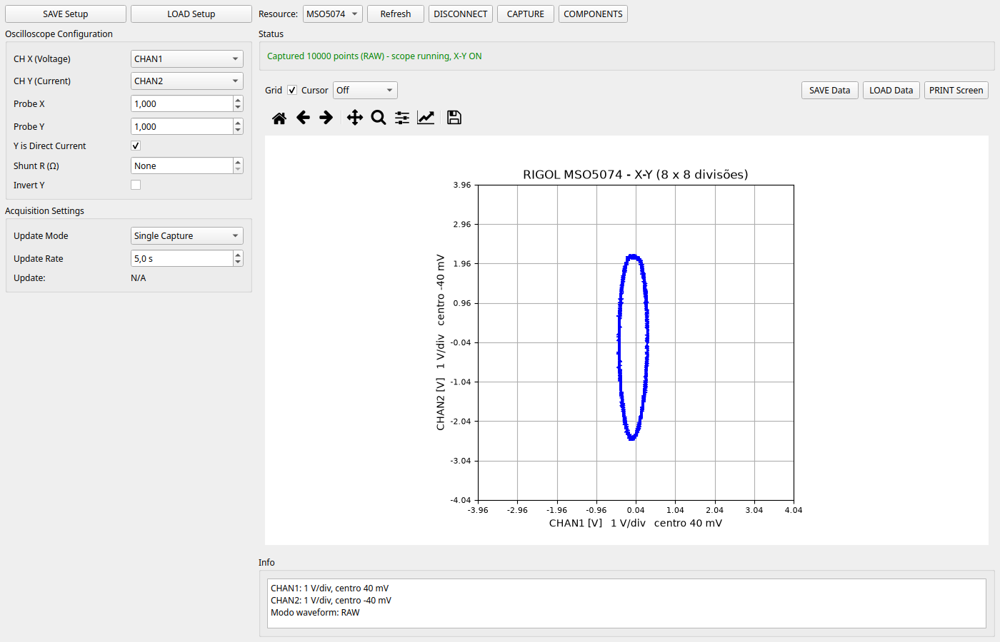
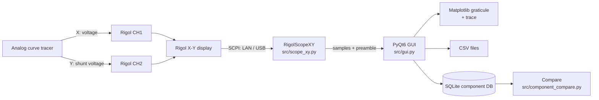
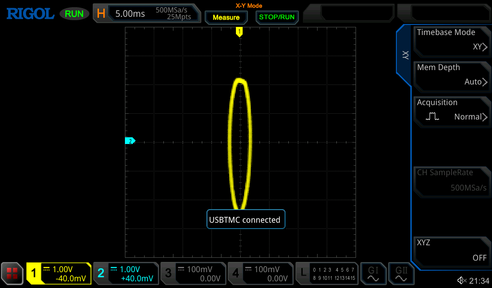
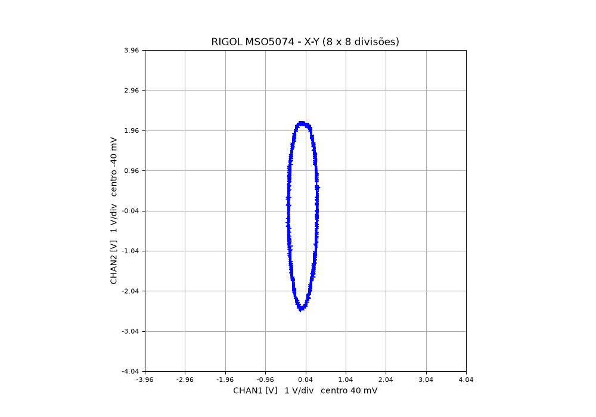

# Blacksmith CurveTracer

**English** | [Português (Brasil)](README.pt-BR.md)

[](https://www.python.org/)
[](LICENSE)
[](#requirements)

> **Project name:** **Blacksmith CurveTracer**. Internal Python module/package
> names (`curvetracer`, `CurveTracer.spec`, `CurveTracer.exe`) remain unchanged
> for compatibility with existing builds and scripts.

**Blacksmith CurveTracer** is an open-source oscilloscope-based curve tracer for
characterizing diodes, transistors, MOSFETs and other analog devices. It reads
the **X-Y display** of a Rigol DHO800/DHO900 or MSO5000 oscilloscope, pairs the
two channels sample by sample, and draws the V-I curve on a PC with the same
graticule as the instrument.

The project supports both **LAN (TCP/IP socket)** and **USB-TMC** connections,
includes a component registry with reference images, pin maps, saved V-I
captures and automatic reference-vs-live comparison, and ships with a Windows
build script based on PyInstaller.



---

## Table of contents

- [Overview](#overview)
- [Features](#features)
- [Supported hardware](#supported-hardware)
- [Architecture](#architecture)
- [Requirements](#requirements)
- [Installation](#installation)
- [Quick start](#quick-start)
- [Wiring and measurement setup](#wiring-and-measurement-setup)
- [Using the GUI](#using-the-gui)
- [Capture pipeline](#capture-pipeline)
- [Display scale and math](#display-scale-and-math)
- [Data formats](#data-formats)
- [Component registry](#component-registry)
- [SCPI compatibility matrix](#scpi-compatibility-matrix)
- [Configuration and environment variables](#configuration-and-environment-variables)
- [Building the Windows executable](#building-the-windows-executable)
- [Testing](#testing)
- [Troubleshooting](#troubleshooting)
- [Performance notes](#performance-notes)
- [Known limitations](#known-limitations)
- [Project structure](#project-structure)
- [Development](#development)
- [Safety](#safety)
- [License](#license)
- [Contributing](#contributing)
- [Acknowledgments](#acknowledgments)
- [Version history](#version-history)

---

## Overview

An analog curve tracer applies a swept voltage (or current) to a device under
test and produces a V-I characteristic. When the tracer's X and Y outputs are
connected to an oscilloscope in **X-Y mode**, the oscilloscope displays the
curve directly on its screen.

This application turns that display into digital data:

```
Analog curve tracer (X = voltage, Y = current)
        │
        ├── CH1 (X) ──┐
        └── CH2 (Y) ──┤
                       ▼
            Rigol DHO800/DHO900 or MSO5000
                 (X-Y display)
                       │  SCPI over LAN or USB
                       ▼
            Blacksmith CurveTracer (PC, Python + PyQt6)
                       │
                       ├── live graticule + trace
                       ├── CSV export / import
                       └── SQLite component registry + comparison
```

The GUI reproduces the instrument's X-Y graticule, keeps the original sample
order, and never sorts, smooths, closes or normalizes the curve. A vertical
line remains vertical; a capacitor ellipse keeps its proportions.

**Project status:** actively developed and validated on real hardware with a
**Rigol DHO924S** (firmware `00.01.04`, LAN) and a **Rigol MSO5074** (firmware
`00.01.03.03.00`, USB). Other DHO800/900 and MSO5000 models are expected to work
when their firmware follows the same programming guides.

---

## Features

- **I-V curve acquisition** from the oscilloscope X-Y display.
- **Dual Rigol families** with automatic model detection from `*IDN?`:
  - DHO800/DHO900 (configurable X/Y sources);
  - MSO5000 (X-Y fixed at CH1/CH2, `:TIMebase:MODE XY`).
- **10,000-point captures** on both families (MSO uses a temporary 10k memory
  depth so the raw window covers the whole screen).
- **LAN and USB** transports:
  - raw TCP socket on port 5555;
  - PyVISA (NI-VISA or pyvisa-py);
  - direct PyUSBTMC (Linux, pyusb);
  - `/dev/usbtmc` fallback.
- **Automatic discovery** of Rigol devices on the local network and on USB.
- **Single capture** and **real-time streaming** modes with a configurable
  update interval.
- **Instrument-faithful graticule**: 8 x 8 divisions, span = 8 x V/div,
  center = `-offset`, with SI-prefixed axis labels.
- **Cursor readout** (`Off`, `Free`, `Single-Plot`) in physical units.
- **CSV export/import** and **setup save/load** (JSON).
- **Component registry** (SQLite): reference photos, pin maps with normalized
  coordinates, metadata, saved V-I captures, import/export.
- **Reference vs. live comparison**: interpolation for monotonic curves and
  geometric comparison for loops, with RMS/NRMSE/max/P95/correlation and a
  MATCH / WARNING / DEVIATION verdict.
- **Headless/self-check mode** for CI and frozen builds.
- **Windows executable** build with PyInstaller and a GitHub Actions workflow.

---

## Supported hardware

### Oscilloscopes

| Family | Models | Status |
|---|---|---|
| Rigol DHO800 | DHO820, DHO840, DHO860, DHO880 | Expected to work (same SCPI dialect) |
| Rigol DHO900 | DHO920, DHO940, DHO960, DHO980 | **DHO924S tested** |
| Rigol MSO5000 | MSO5072, MSO5074, MSO5102, MSO5104, MSO5204, MSO5354 | **MSO5074 tested** |
| Other Rigol scopes | Any model compatible with the DHO800/900 or MSO5000 programming guides | Experimental |

### Tested configurations

| Instrument | Connection | Firmware | Result |
|---|---|---|---|
| DHO924S | LAN socket, port 5555 | `00.01.04` | 10,000-point RAW capture, X-Y preserved |
| MSO5074 | USB (PyUSBTMC) | `00.01.03.03.00` | 10,000-point RAW capture, X-Y preserved |

### Connection methods

| Method | Example resource | Notes |
|---|---|---|
| LAN raw socket | `TCPIP::192.168.1.150::5555::SOCKET` | Recommended; no VISA driver/backend needed |
| LAN VISA | `TCPIP::192.168.1.150::INSTR` | Requires NI-VISA or pyvisa-py |
| USB with NI-VISA | `USB0::0x1AB1::0x0515::MS5A261500717::INSTR` | Recommended on Windows |
| USB with PyUSBTMC | `PyUSBTMC::1ab1:0515` | Direct pyusb path; used on Linux |
| USB `/dev/usbtmc` | `USB-TMC::/dev/usbtmc0` | Linux kernel driver fallback |

> **X-Y sources:** on the DHO800/DHO900 the X/Y channels can be chosen with
> `:TIMebase:XY:X/Y`. On the MSO5000 the X-Y mode is fixed at **CH1 = X** and
> **CH2 = Y** (the instrument forces CH1/CH2 on and CH3/CH4 off). The driver
> detects the family from `*IDN?` and uses the correct command set.

---

## Architecture



### Module responsibilities

| Module | Responsibility |
|---|---|
| `curvetracer.py` | Entry point for direct execution and PyInstaller; `--self-check` for frozen builds. |
| `src/scope_xy.py` | Transport (socket/VISA/PyUSBTMC), SCPI dialect per family, X-Y capture, waveform parsing, discovery. |
| `src/gui.py` | Main PyQt6 window, worker threads, plotting, cursors, data/setup I/O, component window integration. |
| `src/component_db.py` | SQLite persistence for components, pins and captures; image BLOBs and JSON sample arrays. |
| `src/component_compare.py` | Curve comparison metrics and MATCH/WARNING/DEVIATION verdict. |
| `src/component_gui.py` | Component registry window: profiles, images, pins, captures, comparison. |
| `src/driver.py` | Lower-level/legacy Rigol DHO driver with error-queue helpers (not used by the main GUI). |
| `src/discovery.py` | Legacy discovery helper with subnet scanning (the GUI uses `scope_xy` discovery). |
| `src/curve_reconstruct.py` | I-V reconstruction/validation helpers. |
| `src/simulator.py` | Synthetic curves for offline experiments and tests. |

The main GUI path is `curvetracer.py → src/gui.py → src/scope_xy.py`.

---

## Requirements

### Operating system

- **Linux** (tested) and **Windows 10/11 64-bit** (tested/build supported).
- macOS is expected to work with PyVISA/pyvisa-py but is not officially tested.

### Python

- Python **3.11 or newer**.
- For the Windows PyInstaller build, use **3.11, 3.12 or 3.13, 64-bit** from
  [python.org](https://www.python.org/downloads/windows/). Avoid the Microsoft
  Store alias.

### Python packages

Installed by `requirements.txt`:

| Package | Purpose |
|---|---|
| `PyVISA` | VISA resource manager and instrument I/O |
| `PyVISA-py[usb]` | Pure-Python VISA backend with USB support |
| `numpy` | Numeric arrays and waveform math |
| `matplotlib` | Plotting and graticule |
| `PyQt6` | Desktop GUI |
| `scipy` | Optional numeric helpers |
| `pyserial` | PyVISA serial backend |
| `psutil` | Local network interface detection for discovery |
| `libusb-package` | Windows libusb DLL (installed automatically on Windows) |

Optional:

| Package | Purpose |
|---|---|
| `PyUSBTMC` | Direct USBTMC via pyusb on Linux (`pip install PyUSBTMC`) |
| `pyinstaller` | Windows executable build (`requirements-build.txt`) |
| `pytest` | Test runner (unittest also works) |

### USB drivers

- **Windows:** install **NI-VISA** (recommended) *or* bind the scope to
  **WinUSB** with [Zadig](https://zadig.akeo.ie/) so pyusb/libusb can use it.
  Do not use both drivers for the same interface at the same time.
- **Linux:** libusb must be able to open the device. If you get a permission
  error, add a udev rule (see [Installation](#installation)).

---

## Installation

### Linux (source)

```bash
git clone <repository-url> curve-tracer-oss
cd curve-tracer-oss

python3 -m venv .venv
source .venv/bin/activate
python -m pip install --upgrade pip
pip install -r requirements.txt

# Optional: direct USBTMC path (used by PyUSBTMC:: resources)
pip install PyUSBTMC

python curvetracer.py
```

System packages commonly needed:

```bash
sudo apt install python3-venv libusb-1.0-0
```

If USB access is denied, create `/etc/udev/rules.d/99-rigol.rules`:

```udev
SUBSYSTEM=="usb", ATTR{idVendor}=="1ab1", MODE="0666", GROUP="plugdev"
```

Then reload udev and reconnect the scope:

```bash
sudo udevadm control --reload-rules
sudo udevadm trigger
```

### Windows (source)

1. Install 64-bit Python 3.11–3.13 from python.org.
2. Open `cmd.exe` in the project folder:

```bat
py -3 -m venv .venv
.venv\Scripts\activate
python -m pip install --upgrade pip
pip install -r requirements.txt
python curvetracer.py
```

For USB, install **NI-VISA** (recommended) or use **Zadig/WinUSB** with pyusb.

### macOS (source, experimental)

```bash
python3 -m venv .venv
source .venv/bin/activate
pip install -r requirements.txt
python curvetracer.py
```

Use PyVISA/NI-VISA or pyvisa-py for the instrument connection.

---

## Quick start

1. **Wire the curve tracer** (see [Wiring](#wiring-and-measurement-setup)):
   - tracer X output → oscilloscope **CH1** (voltage);
   - tracer Y/current output → oscilloscope **CH2** (shunt voltage).
2. **Connect the oscilloscope** to the PC via LAN or USB.
3. Launch the application:

   ```bash
   python curvetracer.py
   ```

4. Press **Refresh** to discover devices. Select a resource, or type one
   directly in the editable **Resource** field.
5. Press **CONNECT**. The status bar must show the instrument ID.
6. Configure **CH X**, **CH Y**, probe factors and, if used, the **Shunt R**.
7. Press **CAPTURE**. The curve appears on the 8 x 8 graticule.
8. Use **SAVE Data** for CSV, or **COMPONENTS** to store a reference capture.

---

## Wiring and measurement setup

### Channel mapping

| Scope input | Signal | Axis |
|---|---|---|
| CH1 | Voltage across the device under test (tracer X output) | X |
| CH2 | Current-representing voltage (shunt or current transducer) | Y |

### Probes

- **1x probes** are recommended for best accuracy.
- If you use 10x probes, set **Probe X** / **Probe Y** to `10` in the GUI.
- Keep probe grounds and signal leads short; use proper grounding.

### Shunt resistor

The current is calculated in software:

```text
If Shunt R > 0:
    I = V_CH2 / Shunt_R
Else:
    I = V_CH2   (Y axis remains in volts)
```

- **Shunt R = 0** disables the conversion. The Y axis is displayed in volts.
- **Shunt R > 0** converts the Y data and the Y graticule to amperes.
- The **Y is Direct Current** checkbox is stored in the setup file but the
  numerical conversion is driven by **Shunt R** in the current version.
- Changing the shunt while a curve is already plotted does **not** recalculate
  that curve; press **CAPTURE** again to apply the new value.

### Typical devices

- **Diode:** forward voltage vs. current, reverse leakage, breakdown.
- **BJT:** collector current vs. collector-emitter voltage for different base
  currents (multiple captures).
- **MOSFET:** drain current vs. drain-source voltage for different gate
  voltages.
- **Capacitor:** Lissajous ellipse (phase relationship), useful for checking
  the setup and cabling.

---

## Using the GUI


### Top bar

| Control | Description |
|---|---|
| **SAVE Setup** | Save the current configuration to a JSON file. |
| **LOAD Setup** | Load a JSON configuration; the saved resource is added to the list if needed. |
| **Resource** | Editable combo with discovered devices. You can type a VISA/socket resource directly. |
| **Refresh** | Re-run USB/LAN discovery. |
| **CONNECT** | Connect to the selected resource; becomes **DISCONNECT** when connected. |
| **CAPTURE** | Run a single capture, or start/stop real-time mode. |
| **COMPONENTS** | Open the component registry window. |

### Oscilloscope Configuration

| Setting | Default | Description |
|---|---|---|
| CH X (Voltage) | `CHAN1` | Channel used for the X axis. |
| CH Y (Current) | `CHAN2` | Channel used for the Y axis. |
| Probe X | `1.0` | X-channel probe attenuation (`0.001`–`10000`). |
| Probe Y | `1.0` | Y-channel probe attenuation (`0.001`–`10000`). |
| Y is Direct Current | checked | Persisted in the setup; see the shunt note above. |
| Shunt R (Ω) | `0` (None) | Shunt resistor for `I = V/R`; `0` keeps Y in volts. |
| Invert Y | unchecked | Invert the Y sign after acquisition. |

> On the MSO5000 the X/Y channels are fixed at CH1/CH2; the selectors are
> informational for that family. On the DHO800/DHO900 the selectors are applied
> with `:TIMebase:XY:X/Y` and synchronized on connect.

### Acquisition Settings

| Setting | Default | Description |
|---|---|---|
| Update Mode | `Single Capture` | `Single Capture` or `Real-time`. |
| Update Rate | `5.0 s` | Delay between real-time frames (`0.1`–`10.0 s`). |
| Update | `N/A` | Shows the effective update rate when real-time is running. |

### Capture modes

**Single Capture**

1. Select `Single Capture` in **Update Mode**.
2. Press **CAPTURE**.
3. The acquisition runs in a worker thread (the GUI stays responsive).
4. The scope is stopped only while the frame is read, then resumes in X-Y.
5. The GUI keeps the captured frame; the instrument returns to live display.

**Real-time**

1. Select `Real-time`.
2. Set the update interval.
3. Press **CAPTURE**; the button becomes **STOP Real-time**.
4. Press it again (or **STOP**) to stop streaming.

### Graph toolbar

| Control | Description |
|---|---|
| **Grid** | Show/hide the graticule. |
| **Cursor** | `Off`, `Free` (follows the mouse) or `Single-Plot` (click to place/move). |
| **SAVE Data** | Export the current curve to CSV. |
| **LOAD Data** | Import a CSV curve for offline analysis. |
| **PRINT Screen** | Save the figure as PNG/JPG at 150 DPI. |

The **Info** panel shows each channel's scale, center and the waveform mode used
(`RAW`, `MAX` or `NORM`).

### Display states

| State | What is shown |
|---|---|
| Opened, not connected | No graph; a centered "No data" hint. |
| Connected, no capture | Empty 8 x 8 graticule using the instrument's current scale/offset. |
| After capture / LOAD Data | Graticule + curve at the instrument scale. |

The empty grid refreshes when the X/Y channel or shunt changes. A plotted curve
is not recalculated until the next capture.

---

## Capture pipeline

The driver performs the following sequence for a single capture:

1. **Identify the instrument** with `*IDN?` and select the DHO or MSO dialect.
2. **Ensure X-Y mode**:
   - DHO: `:TIMebase:XY:ENABle ON`;
   - MSO: `:TIMebase:MODE XY`.
3. **Synchronize the X/Y sources**:
   - DHO: query/set `:TIMebase:XY:X` and `:TIMebase:XY:Y`;
   - MSO: fixed CH1/CH2 (no command is sent).
4. **Prepare the MSO memory depth** (first capture only):
   - set `:ACQ:MDEP 10k`, run briefly and stop, so 10,000 RAW points cover
     the whole displayed time window;
   - this is restored to `:ACQ:MDEP AUTO` on disconnect.
5. **Stop the acquisition** so both channels are read from the same frame.
6. **Check channel display** with `:CHANnel<n>:DISPlay?`; avoid redundant
   `DISP ON` writes (they can clear the X-Y trace on the DHO).
7. **Configure the waveform**:
   - `:WAVeform:SOURce`, `:WAVeform:MODE`, `:WAVeform:FORMat BYTE`;
   - `:WAVeform:STARt 1` / `:WAVeform:STOP <points>`.
8. **Read the preamble** with `:WAVeform:PREamble?`.
9. **Read the binary block** with `:WAVeform:DATA?`, parse the TMC header
   (`#N...`) and convert:
   `V = (raw - YREFerence - YORigin) * YINCrement`.
10. **Pair the channels by index** (`vx[i], vy[i]` are the same time sample).
11. **Apply probe, shunt and inversion**:
    - multiply by the probe factor;
    - `I = V / R` when `Shunt R > 0`;
    - negate Y if **Invert Y** is checked.
12. **Resume acquisition** (unless `resume_after=False`).

### Waveform modes and point counts

| Family | Default mode | Points | Condition |
|---|---|---|---|
| DHO800/DHO900 | `RAW` | 10,000 | Memory depth ≤ 10k (normal case). |
| DHO800/DHO900 | `NORM` | 1,000 screen points | Memory depth > 10k (fallback). |
| MSO5000 | `RAW` | 10,000 | App sets `:ACQ:MDEP 10k` on first capture. |
| MSO5000 | `NORM` | 1,000 screen points | If the memory depth cannot be reduced or is manually set > 10k. |
| Both | `MAX` | up to screen/memory | Intermediate fallback. |

`WAVEFORM_MAX_POINTS` is 10,000 in `src/scope_xy.py`.

---

## Display scale and math

Both tested families use a **square 8 x 8 X-Y graticule** (the MSO switches from
its 10-column YT grid to a square X-Y area).

For each axis:

```text
span   = 8 * Volts_per_division
center = -offset
min    = center - span / 2
max    = center + span / 2
```

This follows the Rigol preamble formula:

```text
V = (raw - YREFerence - YORigin) * YINCrement
```

At the screen center, `raw == YREFerence`, so `V == -YORigin * YINCrement`,
which is `-offset`. The GUI uses this convention for the graticule, the cursor
and the axis labels.

- **No axis normalization** is applied. The original sample pairs are preserved.
- **Shunt conversion** also divides the Y scale and center by `R`, so the grid
  remains physically correct in amperes.
- **Probe factors** multiply the corresponding channel data.

Example: CH1 `0.2 V/div`, offset `+24.2 mV` → X spans `1.6 V`, centered at
`-24.2 mV`. CH2 `1 V/div`, offset `+8.78 mV` → Y spans `8 V`, centered at
`-8.78 mV`.

### Verified: instrument screen vs. GUI

The screenshots below were taken from the same MSO5074 session. The GUI uses the
same 8 x 8 graticule, the same scale/offset and the same sample pairs, so the
curve shape and position match the instrument display.

| Rigol MSO5074 X-Y screen | Blacksmith CurveTracer GUI |
|---|---|
|  |  |

---

## Data formats

### CSV export/import

`SAVE Data` writes:

```csv
Voltage_V,Current_A
-1.234,0.000123
...
```

- Samples are written in **acquisition order**, without sorting or smoothing.
- `LOAD Data` accepts `Voltage_V`/`Current_A`, `V`/`I` or `X`/`Y` headers, and
  also a two-column file without a header.
- The header is currently fixed as `Voltage_V,Current_A`. When **Shunt R = 0**
  the second column contains the Y-axis voltage (the Y axis label in the GUI
  shows `V`).

### Setup JSON

`SAVE Setup` writes:

```json
{
  "resource": "TCPIP::192.168.1.150::5555::SOCKET",
  "ch_x": "CHAN1",
  "ch_y": "CHAN2",
  "probe_x": 1.0,
  "probe_y": 1.0,
  "y_direct": true,
  "shunt": 0.0,
  "invert": false,
  "update_mode": "Single Capture",
  "update_rate": 5.0
}
```

`LOAD Setup` restores all fields and adds the saved resource to the combo if it
is not already present.

### Component database

- Default: `~/.curvetracer/components.db`.
- Override: `CURVETRACER_DB=/path/to/lab.db`.
- Tables: `components`, `pins`, `captures`.
- Images are stored as BLOBs with detected MIME type.
- Captures store X and Y as JSON arrays, preserving order and every sample.
- Deleting a component removes its pins and captures; deleting a pin keeps its
  captures and only clears the pin association.

---

## Component registry

Open it with **COMPONENTS** in the main window. It is a separate, non-modal
window with three tabs.

### Profile & Pins

- Reference image (PNG/JPEG) stored in SQLite.
- Pin map: enable **ADD Pin on image** and click the photo. Coordinates are
  stored normalized (`0..1`), so they scale with the window.
- Pins can also be created without an image position and edited in the table
  (number, label, X, Y).
- Metadata: reference (required), manufacturer, package, tags, notes.

### Captures

- **CAPTURE Now + SAVE** acquires one frame and saves it immediately, even when
  the main window is in Real-time mode.
- **SAVE Current Capture** stores the curve currently shown in the main window.
- **IMPORT CSV** accepts the same format as `LOAD Data`.
- Every sample is stored in acquisition order with its units and label.

### Compare

1. Select a saved capture as reference.
2. Press **USE Current Capture** (or **CAPTURE + COMPARE** to acquire a new one).
3. Adjust **Tolerance** and press **COMPARE**.

The window reports:

- method used (interpolation or geometric);
- number of samples compared;
- RMS error and normalized RMS error (NRMSE);
- maximum and P95 deviation;
- correlation;
- verdict **MATCH**, **WARNING** or **DEVIATION**.

Verdict rules (default tolerance 5% of the reference Y span):

| Verdict | Criterion |
|---|---|
| **MATCH** | NRMSE ≤ tolerance, max deviation ≤ 2 × tolerance, correlation ≥ 0.90 |
| **WARNING** | NRMSE ≤ 2 × tolerance and max deviation ≤ 4 × tolerance |
| **DEVIATION** | beyond the warning limits (anomaly) |

Comparison methods are chosen automatically:

- **Interpolation** for curves monotonic in X: both curves are interpolated on
  the overlapping X range; errors are computed in Y units.
- **Geometric** for loops/non-monotonic V-I traces: symmetric nearest-neighbor
  distance in coordinates normalized by the reference spans. This compares
  shape without requiring X to be a function or the sample order to match.

Stored samples are never sorted, smoothed, closed or modified by the comparison.
Units must match (`V/A` vs. `V/V` is rejected).


---

## SCPI compatibility matrix

The driver uses the commands shared by the DHO800/900 and MSO5000 programming
guides, selecting family-specific commands when needed.

| Command | DHO800/900 | MSO5000 | Notes |
|---|---|---|---|
| `*IDN?` | ✅ | ✅ | Model/family detection |
| `:RUN` / `:STOP` / `:SING` | ✅ | ✅ | Acquisition control |
| `:TIMebase:MODE XY` | ✅ | ✅ | Used for MSO X-Y; also valid on DHO |
| `:TIMebase:MODE?` | ✅ | ✅ | DHO returns MAIN/ROLL; MSO returns XY in X-Y |
| `:TIMebase:XY:ENABle` | ✅ | ❌ | DHO-specific X-Y enable |
| `:TIMebase:XY:X` / `:Y` | ✅ | ❌ | DHO-specific X/Y sources |
| `:CHANnel<n>:SCALe?` | ✅ | ✅ | Vertical scale |
| `:CHANnel<n>:OFFSet?` | ✅ | ✅ | Vertical offset |
| `:CHANnel<n>:DISPlay?` | ✅ | ✅ | Channel display state |
| `:CHANnel<n>:COUPling` | ✅ | ✅ | AC/DC/GND |
| `:CHANnel<n>:PROBe` | ✅ | ✅ | Probe attenuation |
| `:WAVeform:SOURce` | ✅ | ✅ | CH1/CH2 source |
| `:WAVeform:MODE` | ✅ | ✅ | `RAW` / `MAX` / `NORM` |
| `:WAVeform:FORMat BYTE` | ✅ | ✅ | 8-bit samples |
| `:WAVeform:STARt` / `:STOP` | ✅ | ✅ | RAW reading range |
| `:WAVeform:PREamble?` | ✅ | ✅ | 10 parameters |
| `:WAVeform:DATA?` | ✅ | ✅ | TMC binary block |
| `:ACQuire:MDEPth?` | ✅ | ✅ | Memory depth / mode selection |
| `:ACQuire:SRATe?` | ✅ | ✅ | Sample rate |
| `:SYSTem:ERRor?` | ✅ | ✅ | Error queue |
| `:TRIGger:EDGE:*` | ✅ | ✅ | Available; not used in X-Y capture |

The reference PDFs are in [`docs/`](docs/):
`DHO800900_ProgrammingGuide_EN.pdf` and `MSO5_programming_guide.pdf`.

---

## Configuration and environment variables

| Variable | Effect |
|---|---|
| `CURVETRACER_DB` | Path to the component SQLite database. |
| `CURVETRACER_SKIP_DISCOVERY` | Skip USB/LAN discovery during GUI initialization and refresh. Used by tests and builds. |
| `CURVETRACER_NO_DISCOVERY` | Alias for `CURVETRACER_SKIP_DISCOVERY`. |
| `QT_QPA_PLATFORM` | Set to `offscreen` for headless tests; Linux `main()` defaults to `xcb`. |
| `LOCALAPPDATA` | Windows location for the frozen-app log (`%LOCALAPPDATA%\CurveTracer\curvetracer.log`). |

Example headless test run:

```bash
QT_QPA_PLATFORM=offscreen \
CURVETRACER_SKIP_DISCOVERY=1 \
CURVETRACER_NO_DISCOVERY=1 \
python -m pytest tests -q
```

---

## Building the Windows executable

> **Important:** PyInstaller is not a cross-compiler. A Windows `.exe` must be
> built on Windows (native or a Windows CI runner). Building on Linux/WSL
> produces a Linux binary.

### Local build

```bat
cd /d E:\path\to\curve-tracer-oss
build_windows.bat
```

The script:

1. finds a supported 64-bit Python (3.11–3.13);
2. creates/uses `.venv-win`;
3. installs `requirements.txt` and `requirements-build.txt`;
4. runs the test suite with discovery disabled and `QT_QPA_PLATFORM=offscreen`;
5. generates `build\blacksmith.ico` from `docs\images\blacksmith.jpeg`;
6. builds with `python -m PyInstaller --noconfirm --clean CurveTracer.spec`;
7. runs `dist\CurveTracer\CurveTracer.exe --self-check`;
8. checks that `dist\CurveTracer\CurveTracer.exe` exists.

Result:

```text
dist\CurveTracer\CurveTracer.exe
```

Distribute the **whole `dist\CurveTracer` folder** (zipped), not only the
`.exe`.

### Manual build

```bat
py -3 -m venv .venv-win
.venv-win\Scripts\activate
python -m pip install --upgrade pip
python -m pip install -r requirements.txt -r requirements-build.txt
python -m unittest discover -s tests
python -m PyInstaller --noconfirm --clean CurveTracer.spec
dist\CurveTracer\CurveTracer.exe --self-check
```

### GitHub Actions

The workflow [`.github/workflows/build-windows.yml`](.github/workflows/build-windows.yml)
builds on `windows-latest` and uploads the `dist/CurveTracer` folder as the
`CurveTracer-windows` artifact. Run it manually from **Actions → Build Windows
executable → Run workflow**, or push a tag such as `v2.1.0`.

### Application icon

The Windows executable icon is generated from
[`docs/images/blacksmith.jpeg`](docs/images/blacksmith.jpeg) on every build by
[`tools/make_icon.py`](tools/make_icon.py). The script creates
`build/blacksmith.ico` (16–256 px, square crop) and `CurveTracer.spec` passes it
to PyInstaller; `build_windows.bat` also runs the script before the build.
Replace that JPEG to change the icon; Pillow is listed in
`requirements-build.txt`. The same image is bundled as
`assets/blacksmith.jpeg` and used as the GUI window/taskbar icon at runtime.

### Self-check and logs

`CurveTracer.exe --self-check` verifies imports, Qt, Matplotlib, PyVISA,
pyvisa-py and libusb without opening the main window. In a windowed build,
diagnostics are written to:

```text
%LOCALAPPDATA%\CurveTracer\curvetracer.log
```

### What is bundled

`CurveTracer.spec` includes PyQt6, Matplotlib, NumPy, SciPy, all pyvisa-py
backends, pyserial, pyusb, the `usb.backend.*` modules and, on Windows, the
`libusb-1.0.dll` from `libusb-package`. `PyUSBTMC`/`cPyUSBTMC` are included only
when installed at build time. The reference PDFs and `examples/` are not
bundled.

---

## Testing

### Run the suite

```bash
# pytest
python -m pytest tests -q

# or unittest (same tests, used by build_windows.bat)
python -m unittest discover -s tests
```

Current status: **127 tests passing**.

Headless:

```bash
QT_QPA_PLATFORM=offscreen \
CURVETRACER_SKIP_DISCOVERY=1 \
CURVETRACER_NO_DISCOVERY=1 \
python -m pytest tests -q
```

### Test files

| File | Coverage |
|---|---|
| `tests/test_scope_commands.py` | SCPI trigger commands and channel normalization. |
| `tests/test_iv_reconstruction.py` | I-V math, display scale, sample order, X-Y sources, discovery. |
| `tests/test_gui_states.py` | GUI states, worker threads, cursor, shunt, geometry fallback. |
| `tests/test_mso_compat.py` | MSO model detection, X-Y dialect, waveform modes, PyUSBTMC, full MSO capture sequence. |
| `tests/test_curvetracer.py` | Entry point and frozen self-check. |
| `tests/test_component_db.py` | SQLite schema, components, pins, captures, images. |
| `tests/test_component_compare.py` | Comparison metrics and verdict rules. |
| `tests/test_component_gui.py` | Component registry window behavior. |

### Hardware validation

- **DHO924S** over LAN: 10,000-point RAW capture, X-Y preserved, scale/offset
  match the instrument screen.
- **MSO5074** over USB: 10,000-point RAW capture after `:ACQ:MDEP 10k`, X-Y
  preserved, scale/offset match the 8 x 8 screen; memory depth restored to
  `AUTO` on disconnect.

The deterministic tests do not require hardware: discovery is mocked and the
MSO/USB behavior is simulated with fake transports.

---

## Troubleshooting

### The scope is not discovered

- **LAN:** confirm the PC and scope are on the same subnet; ping the scope;
  check that TCP port **5555** is reachable and allowed by the firewall.
- **USB:** click **Refresh**. On Linux, check `lsusb` for `1ab1:0515` (MSO) or
  the DHO USB ID; check permissions/udev. On Windows, install NI-VISA or bind
  the device to WinUSB with Zadig.
- Discovery scans up to **1022 hosts** on the local physical interfaces. On a
  large/slow network it can take a few seconds. You can type the resource
  directly in the editable **Resource** field.

### "Failed to connect" / USB timeout

The MSO5074 can stop answering the USBTMC `GET_CAPABILITIES` class request
while its bulk endpoints still work. The driver handles this by creating a
"lite" USBTMC device without `GET_CAPABILITIES` and using only the bulk
endpoints. If connection still fails:

1. Power-cycle the **oscilloscope** with the USB cable connected; wait for it to
   finish booting.
2. Reconnect the USB cable.
3. As a fallback, use **LAN** (`TCPIP::<ip>::5555::SOCKET`).

The error dialog/log may suggest a power cycle. This is expected: a timed-out
USBTMC transfer can leave the instrument's USB stack waiting.

### MSO captures only a small arc / curve differs from the scope

The MSO memory depth must be **10k** so that 10,000 RAW points cover the whole
screen. The driver sets this automatically on the first capture and restores
`AUTO` on disconnect. If you change **Mem Depth** manually to a large value
(e.g., 25M), the driver detects it and falls back to `NORM` (1,000 screen
points), which still matches the display but with lower resolution.

### Wrong curve shape or inverted axis

- Confirm **CH1 = X** and **CH2 = Y**. On the MSO this is fixed.
- Check probe factors and the **Shunt R** value.
- Check **Invert Y** and the scope's channel inversion.
- Confirm the scope is in **X-Y mode**.
- Make sure both channels are displayed and not clipped.

### "No data" after CAPTURE

- Verify the channels are enabled on the scope.
- Check the scope is not in a menu/dialog that blocks acquisition.
- Check `:SYST:ERR?` in the log; the driver prints SCPI errors.
- Try a single capture first, then real-time.

### Setup save/load

The **Resource** field is now editable, and setup files store the selected
resource. Loading a setup adds the saved resource to the combo if it is not in
the current discovery list.

### Logs

- Linux/source: stdout/stderr of the terminal.
- Windows frozen app: `%LOCALAPPDATA%\CurveTracer\curvetracer.log`.
- `CurveTracer.exe --self-check` returns non-zero and prints the failing module
  or DLL.

---

## Performance notes

Measured on the development machine with the tested instruments:

| Operation | DHO924S (LAN) | MSO5074 (USB) |
|---|---|---|
| Connect + IDN | ~1 s | ~0.6–1.3 s |
| First capture (10k) | ~2.1–2.7 s | ~3.0 s (sets 10k memory) |
| Subsequent captures | ~2.1 s | ~2.1 s |
| Points per channel | 10,000 RAW | 10,000 RAW |
| Real-time interval | 0.1–10 s | 0.1–10 s |

- LAN is generally faster and more stable than USB, especially on Windows.
- USB captures include command round-trips and binary transfer; 10k points are
  small (10 KB per channel) but the MSO needs a short re-arm after changing the
  memory depth.
- Real-time mode runs captures in a worker thread, so the GUI remains
  responsive.

---

## Known limitations

- **MSO5000 X-Y sources are fixed at CH1/CH2.** The instrument does not expose
  `:TIMebase:XY:X/Y` for that family.
- **MSO memory depth is changed temporarily.** On the first capture the driver
  sets `:ACQ:MDEP 10k` and restores `AUTO` on disconnect. If the application is
  killed, check the scope's **Mem Depth** menu and set it back to `Auto` if
  desired.
- **Maximum 10,000 points per channel** (`WAVEFORM_MAX_POINTS`). The fallback
  `NORM` mode returns 1,000 screen points.
- **8 x 8 graticule** for both families; the GUI does not reproduce the MSO's
  10-column YT grid because X-Y mode is square.
- **`Y is Direct Current`** is stored in the setup but the numerical conversion
  is driven by **Shunt R**. With `Shunt R = 0` the Y axis is displayed in volts.
- **CSV header** is fixed as `Voltage_V,Current_A`; with no shunt the second
  column is the Y-axis voltage.
- **`src/driver.py` and `src/discovery.py`** are auxiliary/legacy APIs; the
  main GUI uses `src/scope_xy.py`.
- **macOS** is not officially tested.
- **Windows executable** must be built on Windows (PyInstaller does not
  cross-compile).
- **Firmware coverage** is validated on DHO924S `00.01.04` and MSO5074
  `00.01.03.03.00`; other firmware versions may differ.

---

## Project structure

```text
curve-tracer-oss/
├── curvetracer.py              # entry point + --self-check
├── CurveTracer.spec            # PyInstaller one-folder build
├── build_windows.bat           # local Windows build script
├── requirements.txt            # runtime dependencies
├── requirements-build.txt      # PyInstaller/pytest
├── LICENSE                     # MIT
├── README.md                   # this file (English)
├── README.pt-BR.md             # Portuguese (Brazil) README
├── CHANGELOG.md
├── docs/
│   ├── BUILD_WINDOWS.md        # detailed Windows build guide
│   ├── USAGE.md                # usage guide
│   ├── RIGOL_XY.md             # X-Y setup notes
│   ├── ROADMAP.md
│   ├── DHO800900_ProgrammingGuide_EN.pdf
│   ├── MSO5_programming_guide.pdf
│   ├── dho924s_extracted.txt
│   └── images/                 # README screenshots
├── examples/
│   └── rigol_xy_capture.py     # command-line capture example
├── src/
│   ├── scope_xy.py             # transport + SCPI + X-Y capture
│   ├── gui.py                  # PyQt6 main window
│   ├── component_db.py         # SQLite component registry
│   ├── component_compare.py    # curve comparison metrics
│   ├── component_gui.py        # component registry window
│   ├── driver.py               # lower-level/legacy DHO driver
│   ├── discovery.py            # legacy discovery helper
│   ├── curve_reconstruct.py    # I-V reconstruction helpers
│   └── simulator.py            # synthetic curves
├── tools/
│   └── make_icon.py            # JPEG -> build/blacksmith.ico for the EXE
└── tests/                      # 127 automated tests
```

---

## Development

### Running from source

```bash
python curvetracer.py
# or directly:
python src/gui.py
```

### Adding a new SCPI feature

1. Check the command in both programming guides:
   - `docs/DHO800900_ProgrammingGuide_EN.pdf`
   - `docs/MSO5_programming_guide.pdf`
2. If the command is family-specific, gate it with
   `RigolScopeXY._is_mso_family()`.
3. Add a method to `src/scope_xy.py` with a clear docstring and hardware-safe
   fallbacks.
4. Add tests in `tests/` (mock transports; no hardware in CI).
5. Validate on real hardware when possible and note the model/firmware.

### Code style

- Python 3.11+, 4-space indentation.
- Prefer small, testable methods with docstrings in Portuguese or English
  consistent with the surrounding file.
- Never sort, smooth, close or rewrite acquired samples.
- Keep GUI/thread boundaries: instrument I/O runs in worker threads, widgets
  are touched only on the GUI thread.

### Discovery in tests/builds

Set `CURVETRACER_SKIP_DISCOVERY=1` and `CURVETRACER_NO_DISCOVERY=1` to avoid
USB/LAN scanning. `build_windows.bat` does this for the test suite and
`--self-check`.

---

## Safety

This software controls an oscilloscope connected to real circuits. Always:

1. Start with **low voltages and currents**.
2. Use an appropriate **current limit** on the curve tracer / power supply.
3. Verify wiring and polarity before powering the device under test.
4. Respect probe, oscilloscope input and DUT voltage/current ratings.
5. Use proper grounding and isolation; be careful with floating measurements
   and mains-referenced circuits.
6. Never exceed the device under test ratings.

The authors are not responsible for damage, injury or incorrect measurements.

---

## License

MIT License. See [LICENSE](LICENSE).

---

## Contributing

1. Fork the repository.
2. Create a feature branch.
3. Keep changes focused and add/update tests.
4. Run the test suite (headless if needed).
5. Validate on real hardware when the change affects SCPI behavior.
6. Submit a pull request describing the instrument/model/firmware tested.

Bug reports are welcome with:

- instrument model and firmware (`*IDN?`);
- connection method (LAN/USB/VISA/PyUSBTMC);
- operating system and Python version;
- the exact error message and relevant log lines;
- steps to reproduce.

---

## Acknowledgments

- **Rigol** for the DHO800/900 and MSO5000 programming guides and instruments.
- **PyVISA**, **pyvisa-py**, **PyUSBTMC**, **PyQt6**, **Matplotlib**, **NumPy**,
  **SciPy** and the Python community.
- The original CurveTracer OSS project and its contributors.
- Everyone who tested on real hardware and reported timing/USB edge cases.

---

## Version history

See [CHANGELOG.md](CHANGELOG.md). Current version: **2.1.0**.
