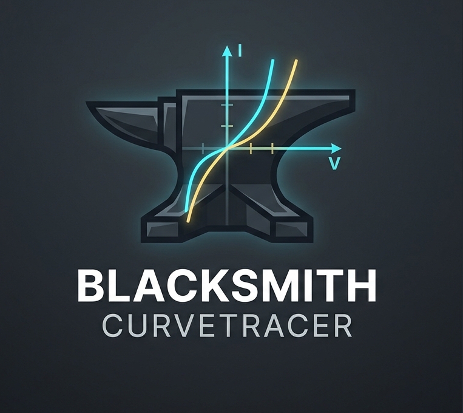
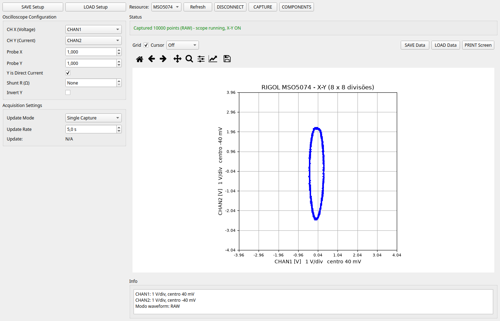
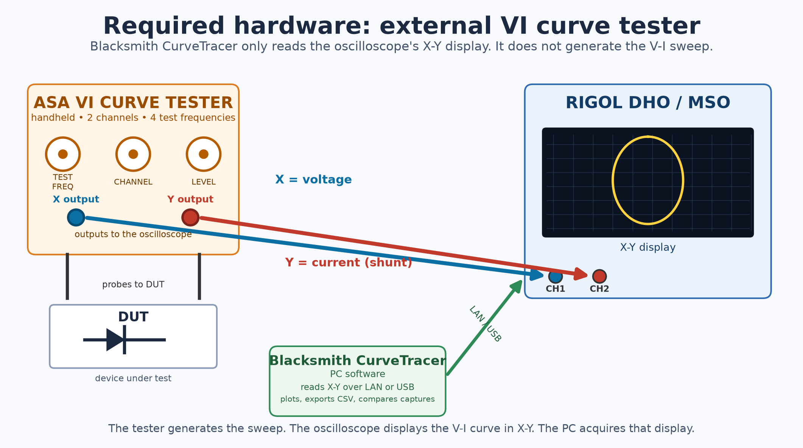
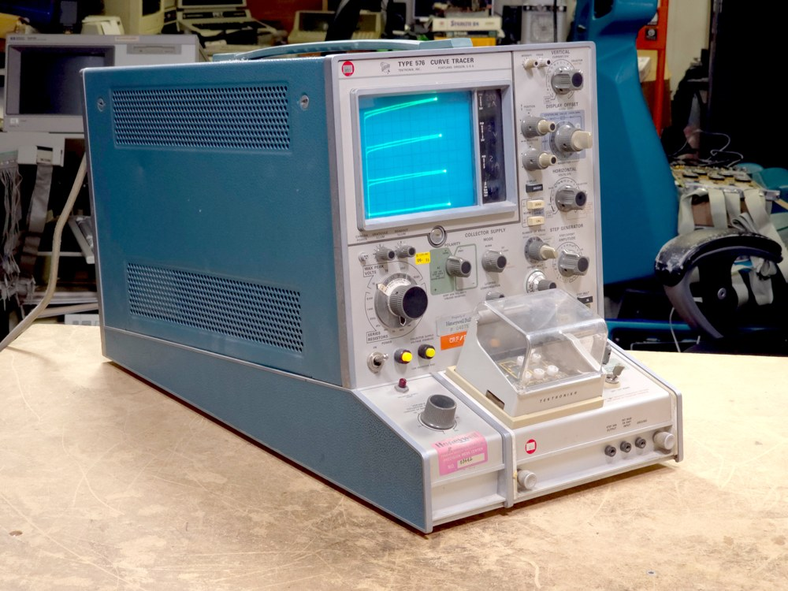
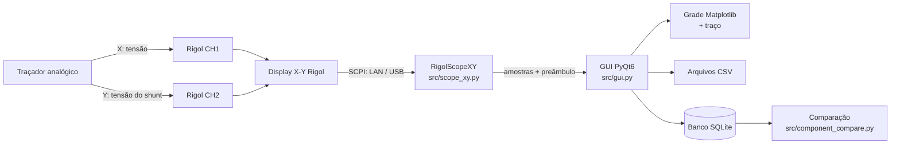
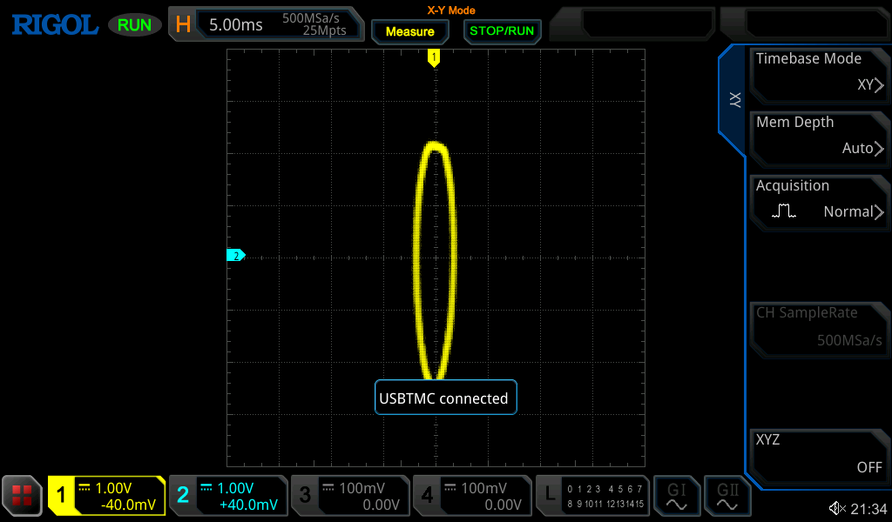
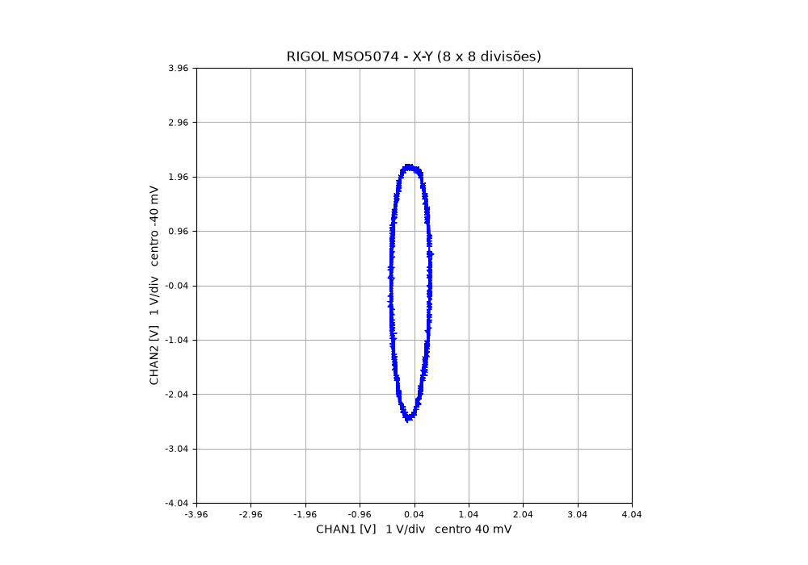
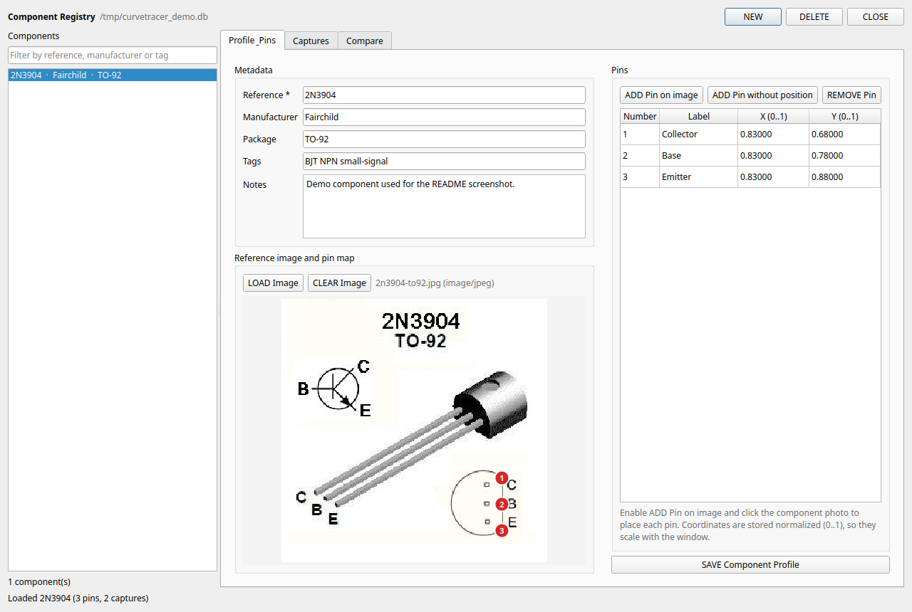
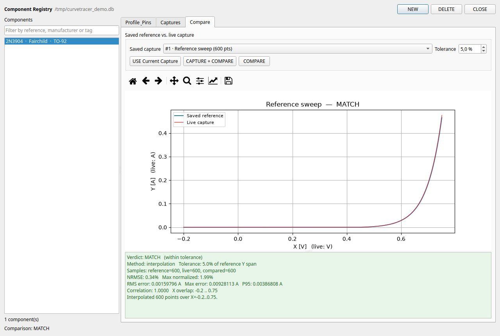

# Blacksmith CurveTracer

[English](README.md) | **Português (Brasil)**

<p align="center">
  
</p>

[](https://www.python.org/)
[](LICENSE)
[](#requisitos)

> **Nome do projeto:** **Blacksmith CurveTracer**. Os nomes internos de
> módulo/pacote (`curvetracer`, `CurveTracer.spec`, `CurveTracer.exe`)
> permanecem inalterados por compatibilidade com builds e scripts existentes.

**Blacksmith CurveTracer** é um traçador de curvas open source baseado em
osciloscópio para caracterizar diodos, transistores, MOSFETs e outros
dispositivos analógicos. Ele lê o **modo X-Y** de um osciloscópio Rigol
DHO800/DHO900 ou MSO5000, emparelha os dois canais amostra por amostra e
desenha a curva V-I no PC com a mesma grade do instrumento.

O projeto suporta conexão **LAN (socket TCP)** e **USB-TMC**, inclui um cadastro
de componentes com imagem de referência, mapa de pinos, capturas V-I salvas e
comparação automática referência × captura atual, além de um script de build
Windows com PyInstaller.

> **⚠️ Isto não é um traçador de curvas autônomo.** O Blacksmith CurveTracer
> apenas adquire e plota o display X-Y do osciloscópio. Você ainda precisa de
> um **testador de curva VI** analógico externo — por exemplo o **ASA VI Curve
> Tester**, um aparelho portátil de 2 canais e 4 frequências — conectado aos
> canais CH1/CH2 do osciloscópio. Veja
> [Hardware necessário](#hardware-necessário-testador-de-curva-vi-externo).



---

## Sumário

- [Visão geral](#visão-geral)
- [Hardware necessário: testador de curva VI externo](#hardware-necessário-testador-de-curva-vi-externo)
- [Recursos](#recursos)
- [Hardware suportado](#hardware-suportado)
- [Arquitetura](#arquitetura)
- [Requisitos](#requisitos)
- [Instalação](#instalação)
- [Início rápido](#início-rápido)
- [Ligação e configuração da medição](#ligação-e-configuração-da-medição)
- [Usando a GUI](#usando-a-gui)
- [Pipeline de captura](#pipeline-de-captura)
- [Escala do display e matemática](#escala-do-display-e-matemática)
- [Formatos de dados](#formatos-de-dados)
- [Cadastro de componentes](#cadastro-de-componentes)
- [Matriz de compatibilidade SCPI](#matriz-de-compatibilidade-scpi)
- [Configuração e variáveis de ambiente](#configuração-e-variáveis-de-ambiente)
- [Build do executável Windows](#build-do-executável-windows)
- [Testes](#testes)
- [Solução de problemas](#solução-de-problemas)
- [Desempenho](#desempenho)
- [Limitações conhecidas](#limitações-conhecidas)
- [Estrutura do projeto](#estrutura-do-projeto)
- [Desenvolvimento](#desenvolvimento)
- [Segurança](#segurança)
- [Licença](#licença)
- [Contribuindo](#contribuindo)
- [Doações](#doações)
- [Agradecimentos](#agradecimentos)
- [Histórico de versões](#histórico-de-versões)

---

## Visão geral

Um traçador analógico aplica uma tensão (ou corrente) varrida ao dispositivo
sob teste e produz uma característica V-I. Quando as saídas X e Y do traçador
são ligadas a um osciloscópio em **modo X-Y**, o osciloscópio mostra a curva
diretamente na tela.

Este programa transforma essa tela em dados digitais:

```
Traçador analógico (X = tensão, Y = corrente)
        │
        ├── CH1 (X) ──┐
        └── CH2 (Y) ──┤
                       ▼
        Rigol DHO800/DHO900 ou MSO5000
                 (display X-Y)
                       │  SCPI via LAN ou USB
                       ▼
        Blacksmith CurveTracer (PC, Python + PyQt6)
                       │
                       ├── grade + traço em tempo real
                       ├── exportação/importação CSV
                       └── cadastro SQLite + comparação
```

A GUI reproduz a grade X-Y do instrumento, mantém a ordem original das amostras
e nunca ordena, suaviza, fecha artificialmente ou normaliza a curva. Uma linha
vertical continua vertical; a elipse de um capacitor mantém as proporções.

**Status do projeto:** em desenvolvimento ativo e validado em hardware real com
um **Rigol DHO924S** (firmware `00.01.04`, LAN) e um **Rigol MSO5074** (firmware
`00.01.03.03.00`, USB). Outros modelos DHO800/900 e MSO5000 devem funcionar
quando o firmware segue os mesmos guias de programação.

---

## Hardware necessário: testador de curva VI externo

**O Blacksmith CurveTracer é a camada de aquisição e análise, não a fonte do
sinal.** Ele não gera a varredura de tensão/corrente e não testa um componente
sozinho. Você precisa de um **testador de curva VI** (curve tracer) analógico
externo, que produza duas tensões analógicas: **X = tensão** e **Y = corrente**
(normalmente a tensão de um shunt).

| Parte | Função | Exemplos |
|---|---|---|
| Testador de curva VI / traçador analógico externo | Gera o sinal varrido e entrega as tensões X/Y | **ASA VI Curve Tester** (portátil, 2 canais, 4 frequências); qualquer traçador analógico com saídas X/Y |
| Rigol DHO800/DHO900 ou MSO5000 | Mostra a curva X-Y e é controlado pelo software | DHO924S, MSO5074 |
| PC + Blacksmith CurveTracer | Adquire os dados X-Y, plota, exporta CSV, armazena e compara capturas | este projeto |

### Ligação



1. Conecte as pontas de prova do testador ao dispositivo sob teste (DUT).
2. Saída **X** (ou canal X) do testador → **CH1** do osciloscópio (tensão).
3. Saída **Y** (ou canal Y) do testador → **CH2** do osciloscópio (corrente/shunt).
   Dependendo do modelo, os dois canais podem ser jacks separados ou
   selecionados por uma chave.
4. Use um terra comum entre o testador e o osciloscópio.
5. Conecte o osciloscópio ao PC via LAN ou USB.

As saídas do testador precisam ser tensões analógicas compatíveis com as
entradas do osciloscópio. Se o testador tiver apenas uma saída, ou nenhuma
saída X/Y, este software não consegue reconstruir a curva V-I.

### Exemplo: ASA VI Curve Tester

O **ASA VI Curve Tester** é um aparelho portátil de baixo custo com **2 canais
e 4 frequências de teste ajustáveis**, feito para injetar um sinal no circuito
e mostrar a curva V-I resultante em um osciloscópio. Dependendo do modelo, as
saídas X/Y podem ser jacks separados ou selecionadas por uma chave de canal.
Pesquise online por **"ASA VI Curve Tester"** ou **"testador de curva VI ASA"**,
ou consulte um fornecedor de eletrônica local. É uma forma comum e acessível de
obter os sinais X/Y que este programa precisa.

> Fotos de anúncios online não foram embutidas aqui porque essas imagens têm
> direitos autorais. Se você tiver um ASA, pode adicionar suas próprias fotos
> em `docs/images/` e referenciá-las nesta seção.

### Como é um traçador de curvas



*Exemplo de um traçador de curvas real (Tektronix 576). O ASA VI Curve Tester é
uma alternativa portátil compacta. Foto: Shelby Jueden, licenciada em
[CC BY-SA 4.0](https://creativecommons.org/licenses/by-sa/4.0/), via
[Wikimedia Commons](https://commons.wikimedia.org/wiki/File:Tek576_CurveTracer_TransistorTest.jpg);
redimensionada para este README. A foto é CC BY-SA 4.0; o restante do projeto é MIT.*

---

## Recursos

- **Aquisição de curvas I-V** a partir do display X-Y do osciloscópio.
- **Duas famílias Rigol** com detecção automática pelo `*IDN?`:
  - DHO800/DHO900 (canais X/Y configuráveis);
  - MSO5000 (X-Y fixo em CH1/CH2, `:TIMebase:MODE XY`).
- **Profundidade de memória selecionável** (padrão **Auto**) com valores
  explícitos de 1k a 200M; capturas de até 1M pontos RAW, ou 1.000 pontos da
  tela para Auto/profundidades maiores, para a curva sempre coincidir com o
  display.
- **Transportes LAN e USB**:
  - socket TCP bruto na porta 5555;
  - PyVISA (NI-VISA ou pyvisa-py);
  - PyUSBTMC direto (Linux, pyusb);
  - fallback `/dev/usbtmc`.
- **Descoberta automática** de dispositivos Rigol na rede local e no USB.
- **Captura única** e **tempo real** com intervalo configurável.
- **Grade fiel ao instrumento**: 8 x 8 divisões, span = 8 x V/div, centro =
  `-offset`, com rótulos em unidades SI.
- **Cursor** (`Off`, `Free`, `Single-Plot`) em unidades físicas.
- **Exportação/importação CSV** e **save/load de setup** (JSON).
- **Cadastro de componentes** (SQLite): fotos de referência, mapa de pinos com
  coordenadas normalizadas, metadados, capturas V-I e importação.
- **Comparação referência × captura atual**: interpolação para curvas
  monotônicas e comparação geométrica para laços, com RMS/NRMSE/máx/P95/
  correlação e veredito MATCH / WARNING / DEVIATION.
- **Modo headless/self-check** para CI e builds congelados.
- **Executável Windows** com PyInstaller e workflow GitHub Actions.

---

## Hardware suportado

### Osciloscópios

| Família | Modelos | Status |
|---|---|---|
| Rigol DHO800 | DHO820, DHO840, DHO860, DHO880 | Esperado (mesmo dialeto SCPI) |
| Rigol DHO900 | DHO920, DHO940, DHO960, DHO980 | **DHO924S testado** |
| Rigol MSO5000 | MSO5072, MSO5074, MSO5102, MSO5104, MSO5204, MSO5354 | **MSO5074 testado** |
| Outros Rigol | Qualquer modelo compatível com os guias DHO800/900 ou MSO5000 | Experimental |

### Configurações testadas

| Instrumento | Conexão | Firmware | Resultado |
|---|---|---|---|
| DHO924S | LAN socket, porta 5555 | `00.01.04` | Capturas RAW Auto/10k/1M, X-Y preservado |
| MSO5074 | USB (PyUSBTMC) | `00.01.03.03.00` | Capturas Auto/NORM e RAW 10k/100k/1M, X-Y preservado |

### Métodos de conexão

| Método | Exemplo de resource | Observações |
|---|---|---|
| LAN socket bruto | `TCPIP::192.168.1.150::5555::SOCKET` | Recomendado; não precisa de driver/backend VISA |
| LAN VISA | `TCPIP::192.168.1.150::INSTR` | Requer NI-VISA ou pyvisa-py |
| USB com NI-VISA | `USB0::0x1AB1::0x0515::MS5A261500717::INSTR` | Recomendado no Windows |
| USB com PyUSBTMC | `PyUSBTMC::1ab1:0515` | Caminho pyusb direto; usado no Linux |
| USB `/dev/usbtmc` | `USB-TMC::/dev/usbtmc0` | Fallback do driver do kernel Linux |

> **Fontes X-Y:** nos DHO800/DHO900 os canais X/Y podem ser escolhidos com
> `:TIMebase:XY:X/Y`. No MSO5000 o modo X-Y é fixo em **CH1 = X** e
> **CH2 = Y** (o instrumento força CH1/CH2 ligados e CH3/CH4 desligados). O
> driver detecta a família pelo `*IDN?` e usa o conjunto de comandos correto.

---

## Arquitetura



### Responsabilidades dos módulos

| Módulo | Responsabilidade |
|---|---|
| `curvetracer.py` | Ponto de entrada para execução direta e PyInstaller; `--self-check` para builds congelados. |
| `src/scope_xy.py` | Transporte (socket/VISA/PyUSBTMC), dialeto SCPI por família, captura X-Y, parsing de waveform e descoberta. |
| `src/gui.py` | Janela principal PyQt6, threads de trabalho, plotagem, cursores, I/O de dados/setup e integração com o cadastro. |
| `src/component_db.py` | Persistência SQLite de componentes, pinos e capturas; imagens em BLOB e amostras em JSON. |
| `src/component_compare.py` | Métricas de comparação e veredito MATCH/WARNING/DEVIATION. |
| `src/component_gui.py` | Janela de cadastro: perfis, imagens, pinos, capturas e comparação. |
| `src/driver.py` | Driver DHO de baixo nível/legado com helpers de error queue (não usado pela GUI principal). |
| `src/discovery.py` | Helper de descoberta legado com varredura de sub-redes (a GUI usa a descoberta do `scope_xy`). |
| `src/curve_reconstruct.py` | Helpers de reconstrução/validação I-V. |
| `src/simulator.py` | Curvas sintéticas para experimentos e testes offline. |

O caminho principal da GUI é `curvetracer.py → src/gui.py → src/scope_xy.py`.

---

## Requisitos

### Sistema operacional

- **Linux** (testado) e **Windows 10/11 64 bits** (testado/build suportado).
- macOS deve funcionar com PyVISA/pyvisa-py, mas não é oficialmente testado.

### Python

- Python **3.11 ou superior**.
- Para o build Windows com PyInstaller, use **3.11, 3.12 ou 3.13, 64 bits** do
  [python.org](https://www.python.org/downloads/windows/). Evite o alias da
  Microsoft Store.

### Pacotes Python

Instalados por `requirements.txt`:

| Pacote | Função |
|---|---|
| `PyVISA` | Resource manager e I/O VISA |
| `PyVISA-py[usb]` | Backend VISA puro em Python com suporte USB |
| `numpy` | Arrays e matemática de waveform |
| `matplotlib` | Plotagem e grade |
| `PyQt6` | GUI desktop |
| `scipy` | Helpers numéricos opcionais |
| `pyserial` | Backend serial do PyVISA |
| `psutil` | Detecção das interfaces de rede para descoberta |
| `libusb-package` | DLL libusb no Windows (instalada automaticamente) |

Opcionais:

| Pacote | Função |
|---|---|
| `PyUSBTMC` | USBTMC direto via pyusb no Linux (`pip install PyUSBTMC`) |
| `pyinstaller` | Build do executável Windows (`requirements-build.txt`) |
| `pytest` | Runner de testes (unittest também funciona) |

### Drivers USB

- **Windows:** instale o **NI-VISA** (recomendado) *ou* vincule o osciloscópio
  ao **WinUSB** com [Zadig](https://zadig.akeo.ie/) para o pyusb/libusb. Não
  use os dois drivers para a mesma interface ao mesmo tempo.
- **Linux:** o libusb precisa abrir o dispositivo. Se houver erro de permissão,
  adicione uma regra udev (veja [Instalação](#instalação)).

---

## Instalação

### Linux (código-fonte)

```bash
git clone <url-do-repositório> curve-tracer-oss
cd curve-tracer-oss

python3 -m venv .venv
source .venv/bin/activate
python -m pip install --upgrade pip
pip install -r requirements.txt

# Opcional: caminho USBTMC direto (resources PyUSBTMC::)
pip install PyUSBTMC

python curvetracer.py
```

Pacotes de sistema comuns:

```bash
sudo apt install python3-venv libusb-1.0-0
```

Se o acesso USB for negado, crie `/etc/udev/rules.d/99-rigol.rules`:

```udev
SUBSYSTEM=="usb", ATTR{idVendor}=="1ab1", MODE="0666", GROUP="plugdev"
```

Recarregue o udev e reconecte o osciloscópio:

```bash
sudo udevadm control --reload-rules
sudo udevadm trigger
```

### Windows (código-fonte)

1. Instale Python 3.11–3.13 64 bits do python.org.
2. Abra o `cmd.exe` na pasta do projeto:

```bat
py -3 -m venv .venv
.venv\Scripts\activate
python -m pip install --upgrade pip
pip install -r requirements.txt
python curvetracer.py
```

Para USB, instale **NI-VISA** (recomendado) ou use **Zadig/WinUSB** com pyusb.

### macOS (código-fonte, experimental)

```bash
python3 -m venv .venv
source .venv/bin/activate
pip install -r requirements.txt
python curvetracer.py
```

Use PyVISA/NI-VISA ou pyvisa-py para conectar ao instrumento.

---

## Início rápido

1. **Prepare o testador de curva VI externo** (veja
   [Hardware necessário](#hardware-necessário-testador-de-curva-vi-externo)) e
   ligue-o ao osciloscópio:
   - saída X do testador → **CH1** do osciloscópio (tensão);
   - saída Y/corrente → **CH2** (tensão do shunt);
   - pontas do testador → dispositivo sob teste; terra comum.
2. **Conecte o osciloscópio** ao PC via LAN ou USB.
3. Execute:

   ```bash
   python curvetracer.py
   ```

4. Clique em **Refresh** para descobrir dispositivos. Selecione um resource ou
   digite diretamente no campo **Resource** (editável).
5. Clique em **CONNECT**. A barra de status deve mostrar o ID do instrumento.
6. Configure **CH X**, **CH Y**, os fatores de sonda e, se usar, o **Shunt R**.
7. Clique em **CAPTURE**. A curva aparece na grade 8 x 8.
8. Use **SAVE Data** para CSV ou **COMPONENTS** para salvar uma referência.

---

## Ligação e configuração da medição

### Mapeamento dos canais

| Entrada do osciloscópio | Sinal | Eixo |
|---|---|---|
| CH1 | Tensão no dispositivo sob teste (saída X do traçador) | X |
| CH2 | Tensão representando corrente (shunt ou transdutor) | Y |

### Sondas

- Sondas **1x** são recomendadas para melhor precisão.
- Se usar sondas 10x, ajuste **Probe X** / **Probe Y** para `10` na GUI.
- Mantenha os cabos curtos e use aterramento adequado.

### Resistor shunt

A corrente é calculada em software:

```text
Se Shunt R > 0:
    I = V_CH2 / Shunt_R
Senão:
    I = V_CH2   (eixo Y permanece em volts)
```

- **Shunt R = 0** desativa a conversão. O eixo Y é exibido em volts.
- **Shunt R > 0** converte os dados e a grade do eixo Y para ampères.
- A caixa **Y is Direct Current** é salva no setup, mas a conversão numérica
  atual é controlada pelo **Shunt R**.
- Alterar o shunt com uma curva já plotada **não** recalcula aquela curva;
  clique em **CAPTURE** novamente para aplicar o novo valor.

### Dispositivos típicos

- **Diodo:** tensão direta vs. corrente, fuga reversa, ruptura.
- **BJT:** corrente de coletor vs. tensão coletor-emissor para diferentes
  correntes de base (várias capturas).
- **MOSFET:** corrente de dreno vs. tensão dreno-fonte para diferentes tensões
  de gate.
- **Capacitor:** elipse de Lissajous (relação de fase), útil para validar a
  montagem e os cabos.

---

## Usando a GUI

A janela principal está mostrada no topo deste README.

### Barra superior

| Controle | Descrição |
|---|---|
| **SAVE Setup** | Salva a configuração atual em JSON. |
| **LOAD Setup** | Carrega um JSON; o resource salvo é adicionado à lista se necessário. |
| **Resource** | Combo editável com dispositivos descobertos. Você pode digitar um resource VISA/socket. |
| **Refresh** | Reexecuta a descoberta USB/LAN. |
| **CONNECT** | Conecta ao resource selecionado; vira **DISCONNECT** quando conectado. |
| **CAPTURE** | Executa uma captura única ou inicia/para o tempo real. |
| **COMPONENTS** | Abre a janela de cadastro de componentes. |

### Oscilloscope Configuration

| Ajuste | Padrão | Descrição |
|---|---|---|
| CH X (Voltage) | `CHAN1` | Canal do eixo X. |
| CH Y (Current) | `CHAN2` | Canal do eixo Y. |
| Probe X | `1.0` | Atenuação da sonda X (`0.001`–`10000`). |
| Probe Y | `1.0` | Atenuação da sonda Y (`0.001`–`10000`). |
| Y is Direct Current | marcado | Salvo no setup; veja a observação do shunt. |
| Shunt R (Ω) | `0` (None) | Resistor shunt para `I = V/R`; `0` mantém Y em volts. |
| Invert Y | desmarcado | Inverte o sinal de Y após a aquisição. |

> No MSO5000 os canais X/Y são fixos em CH1/CH2; os seletores são informativos
> para essa família. No DHO800/DHO900 os seletores são aplicados com
> `:TIMebase:XY:X/Y` e sincronizados na conexão.

### Acquisition Settings

| Ajuste | Padrão | Descrição |
|---|---|---|
| Update Mode | `Single Capture` | `Single Capture` ou `Real-time`. |
| Update Rate | `5.0 s` | Intervalo entre frames em tempo real (`0.1`–`10.0 s`). |
| Mem Depth | `Auto` | Profundidade de memória: `Auto`, `1k`, `10k`, `100k`, `1M`, `5M`/`10M` (DHO) ou `10M`–`200M` (MSO). Profundidades explícitas até 1M são lidas em RAW; Auto/maiores usam 1.000 pontos da tela. |
| Update | `N/A` | Mostra a taxa efetiva quando o tempo real está rodando. |

### Modos de captura

**Single Capture**

1. Selecione `Single Capture` em **Update Mode**.
2. Clique em **CAPTURE**.
3. A aquisição roda em uma thread de trabalho (a GUI não congela).
4. O osciloscópio é parado apenas durante a leitura do frame e depois retoma em
   X-Y.
5. A GUI mantém o frame capturado; o instrumento volta ao display ao vivo.

**Real-time**

1. Selecione `Real-time`.
2. Ajuste o intervalo.
3. Clique em **CAPTURE**; o botão vira **STOP Real-time**.
4. Clique novamente (ou em **STOP**) para parar o streaming.

### Barra do gráfico

| Controle | Descrição |
|---|---|
| **Grid** | Mostra/oculta a grade. |
| **Cursor** | `Off`, `Free` (segue o mouse) ou `Single-Plot` (clique para posicionar/mover). |
| **SAVE Data** | Exporta a curva atual em CSV. |
| **LOAD Data** | Importa uma curva CSV para análise offline. |
| **PRINT Screen** | Salva a figura em PNG/JPG a 150 DPI. |

O painel **Info** mostra escala, centro de cada canal e o modo de waveform usado
(`RAW`, `MAX` ou `NORM`).

### Estados de exibição

| Estado | O que aparece |
|---|---|
| Aberto, sem conexão | Nenhum gráfico; apenas a dica central "No data". |
| Conectado, sem captura | Grade 8 x 8 vazia com a escala/offset atuais do instrumento. |
| Após captura / LOAD Data | Grade + curva na escala do instrumento. |

A grade vazia é atualizada quando o canal X/Y ou o shunt muda. Uma curva já
plotada não é recalculada até a próxima captura.

---

## Pipeline de captura

O driver executa a seguinte sequência em uma captura única:

1. **Identifica o instrumento** com `*IDN?` e escolhe o dialeto DHO ou MSO.
2. **Garante o modo X-Y**:
   - DHO: `:TIMebase:XY:ENABle ON`;
   - MSO: `:TIMebase:MODE XY`.
3. **Sincroniza as fontes X/Y**:
   - DHO: consulta/ajusta `:TIMebase:XY:X` e `:TIMebase:XY:Y`;
   - MSO: fixo CH1/CH2 (nenhum comando é enviado).
4. **Usa a profundidade de memória escolhida na GUI**:
   - o seletor **Mem Depth** escreve `:ACQ:MDEP` (padrão **Auto**);
   - profundidades explícitas até 1M pontos são lidas em `RAW`;
   - `Auto` (ou profundidades acima do limite de segurança de 1M) usa `NORM`
     (1.000 pontos da tela), que sempre corresponde ao traço X-Y exibido;
   - a profundidade escolhida permanece na sessão e `AUTO` é restaurado ao
     desconectar.
5. **Para a aquisição** para ler os dois canais do mesmo frame.
6. **Verifica o display dos canais** com `:CHANnel<n>:DISPlay?`; evita
   reescrever `DISP ON` (no DHO isso pode limpar o traço X-Y).
7. **Configura a waveform**:
   - `:WAVeform:SOURce`, `:WAVeform:MODE`, `:WAVeform:FORMat BYTE`;
   - `:WAVeform:STARt 1` / `:WAVeform:STOP <pontos>`.
8. **Lê o preâmbulo** com `:WAVeform:PREamble?`.
9. **Lê o bloco binário** com `:WAVeform:DATA?`, interpreta o header TMC
   (`#N...`) e converte:
   `V = (raw - YREFerence - YORigin) * YINCrement`.
10. **Emparelha os canais por índice** (`vx[i], vy[i]` são a mesma amostra).
11. **Aplica sonda, shunt e inversão**:
    - multiplica pelo fator de sonda;
    - `I = V / R` quando `Shunt R > 0`;
    - nega Y se **Invert Y** estiver marcado.
12. **Retoma a aquisição** (a menos que `resume_after=False`).

### Modos de waveform e quantidade de pontos

O seletor **Mem Depth** da GUI controla `:ACQuire:MDEPth` (padrão **Auto**).
O modo de captura é escolhido a partir da profundidade real:

| Profundidade selecionada | Modo de leitura | Pontos por canal |
|---|---|---|
| `Auto` com profundidade ≤ 1M | `RAW` | exatamente a profundidade atual |
| `Auto` com profundidade > 1M | `NORM` | 1.000 pontos da tela (igual ao display) |
| `1k`, `10k`, `100k`, `1M` | `RAW` | exatamente a profundidade selecionada |
| `5M`, `10M`, `25M`, `50M`, `100M`, `200M` | `NORM` | 1.000 pontos da tela (acima do limite) |
| Qualquer modo, se RAW falhar | `MAX` / `NORM` | fallback |

- **`WAVEFORM_MAX_POINTS = 1_000_000`** é um limite de segurança para
  transferência/plotagem RAW, não um limite do instrumento. Profundidades
  maiores são lidas como dados da tela para a curva continuar fiel ao display
  e a GUI responsiva.
- A profundidade selecionada permanece ativa durante a sessão. Ao desconectar,
  o driver restaura `AUTO`.
- Em capturas RAW de 1M, o caminho PyUSBTMC junta várias transferências USBTMC
  (o MSO divide blocos grandes em partes de ~200 KB).

---

## Escala do display e matemática

As duas famílias testadas usam uma **grade X-Y quadrada de 8 x 8** (o MSO troca
a grade YT de 10 colunas por uma área X-Y quadrada).

Para cada eixo:

```text
span   = 8 * Volts_por_divisão
centro = -offset
min    = centro - span / 2
max    = centro + span / 2
```

Isso segue a fórmula do preâmbulo Rigol:

```text
V = (raw - YREFerence - YORigin) * YINCrement
```

No centro da tela, `raw == YREFerence`, então `V == -YORigin * YINCrement`,
que é `-offset`. A GUI usa essa convenção para a grade, o cursor e os rótulos.

- **Nenhuma normalização entre eixos** é aplicada. Os pares originais são
  preservados.
- **Conversão por shunt** também divide a escala e o centro de Y por `R`, para
  a grade continuar fisicamente correta em ampères.
- **Fatores de sonda** multiplicam os dados do canal correspondente.

Exemplo: CH1 `0.2 V/div`, offset `+24,2 mV` → X cobre `1,6 V`, centrado em
`-24,2 mV`. CH2 `1 V/div`, offset `+8,78 mV` → Y cobre `8 V`, centrado em
`-8,78 mV`.

### Verificado: tela do instrumento vs. GUI

As capturas abaixo são da mesma sessão com o MSO5074. A GUI usa a mesma grade
8 x 8, a mesma escala/offset e os mesmos pares de amostras, então a forma e a
posição da curva coincidem com o display do instrumento.

| Tela X-Y do MSO5074 | GUI do Blacksmith CurveTracer |
|---|---|
|  |  |

---

## Formatos de dados

### Exportação/importação CSV

**SAVE Data** grava:

```csv
Voltage_V,Current_A
-1.234,0.000123
...
```

- As amostras são gravadas na **ordem de aquisição**, sem ordenação ou
  suavização.
- **LOAD Data** aceita headers `Voltage_V`/`Current_A`, `V`/`I` ou `X`/`Y`, e
  também um arquivo de duas colunas sem header.
- O header é fixo em `Voltage_V,Current_A`. Quando **Shunt R = 0**, a segunda
  coluna contém a tensão do eixo Y (a GUI mostra `V` no eixo).

### Setup JSON

**SAVE Setup** grava:

```json
{
  "resource": "TCPIP::192.168.1.150::5555::SOCKET",
  "ch_x": "CHAN1",
  "ch_y": "CHAN2",
  "probe_x": 1.0,
  "probe_y": 1.0,
  "y_direct": true,
  "shunt": 0.0,
  "invert": false,
  "update_mode": "Single Capture",
  "update_rate": 5.0
}
```

**LOAD Setup** restaura todos os campos e adiciona o resource salvo à combo se
ele não estiver presente.

### Banco de componentes

- Padrão: `~/.curvetracer/components.db`.
- Override: `CURVETRACER_DB=/caminho/lab.db`.
- Tabelas: `components`, `pins`, `captures`.
- Imagens em BLOB com MIME type detectado.
- Capturas guardam X e Y como arrays JSON, preservando ordem e todas as
  amostras.
- Excluir um componente remove seus pinos e capturas; excluir um pino mantém as
  capturas e apenas limpa a associação.

---

## Cadastro de componentes

Abra com **COMPONENTS** na janela principal. É uma janela separada, não modal,
com três abas.



### Perfil e pinos

- Imagem de referência (PNG/JPEG) armazenada no SQLite.
- Mapa de pinos: ative **ADD Pin on image** e clique na foto. As coordenadas
  são normalizadas (`0..1`) e escalam com a janela.
- Pinos também podem ser criados sem posição e editados na tabela (número,
  label, X, Y).
- Metadados: referência (obrigatória), fabricante, encapsulamento, tags e
  notas.

### Capturas

- **CAPTURE Now + SAVE** adquire um frame e salva imediatamente, mesmo com a
  janela principal em tempo real.
- **SAVE Current Capture** salva a curva exibida na janela principal.
- **IMPORT CSV** aceita o mesmo formato do **LOAD Data**.
- Cada amostra é salva na ordem de aquisição, com unidades e label.

### Comparação

1. Selecione uma captura salva como referência.
2. Clique em **USE Current Capture** (ou **CAPTURE + COMPARE** para adquirir
   uma nova).
3. Ajuste **Tolerance** e clique em **COMPARE**.

A janela mostra:

- método usado (interpolação ou geométrico);
- número de amostras comparadas;
- erro RMS e erro RMS normalizado (NRMSE);
- desvio máximo e P95;
- correlação;
- veredito **MATCH**, **WARNING** ou **DEVIATION**.

Regras do veredito (tolerância padrão de 5% do span Y da referência):

| Veredito | Critério |
|---|---|
| **MATCH** | NRMSE ≤ tolerância, desvio máximo ≤ 2 × tolerância e correlação ≥ 0,90 |
| **WARNING** | NRMSE ≤ 2 × tolerância e desvio máximo ≤ 4 × tolerância |
| **DEVIATION** | além dos limites de warning (anomalia) |

Os métodos são escolhidos automaticamente:

- **Interpolação** para curvas monotônicas em X: as duas curvas são
  interpoladas na faixa X comum e os erros são calculados em unidades de Y.
- **Geométrico** para laços/traços V-I não monotônicos: distância simétrica de
  vizinho mais próximo em coordenadas normalizadas pelos spans da referência.
  Compara a forma sem exigir que X seja função ou que a ordem das amostras
  coincida.

As amostras salvas nunca são ordenadas, suavizadas, fechadas ou modificadas
pela comparação. As unidades precisam coincidir (`V/A` vs. `V/V` é rejeitado).



---

## Matriz de compatibilidade SCPI

O driver usa os comandos compartilhados pelos guias DHO800/900 e MSO5000,
escolhendo comandos específicos quando necessário.

| Comando | DHO800/900 | MSO5000 | Observações |
|---|---|---|---|
| `*IDN?` | ✅ | ✅ | Detecção de modelo/família |
| `:RUN` / `:STOP` / `:SING` | ✅ | ✅ | Controle de aquisição |
| `:TIMebase:MODE XY` | ✅ | ✅ | Usado no X-Y do MSO; também válido no DHO |
| `:TIMebase:MODE?` | ✅ | ✅ | DHO retorna MAIN/ROLL; MSO retorna XY em X-Y |
| `:TIMebase:XY:ENABle` | ✅ | ❌ | Habilitação X-Y específica do DHO |
| `:TIMebase:XY:X` / `:Y` | ✅ | ❌ | Fontes X/Y específicas do DHO |
| `:CHANnel<n>:SCALe?` | ✅ | ✅ | Escala vertical |
| `:CHANnel<n>:OFFSet?` | ✅ | ✅ | Offset vertical |
| `:CHANnel<n>:DISPlay?` | ✅ | ✅ | Estado de exibição do canal |
| `:CHANnel<n>:COUPling` | ✅ | ✅ | AC/DC/GND |
| `:CHANnel<n>:PROBe` | ✅ | ✅ | Atenuação da sonda |
| `:WAVeform:SOURce` | ✅ | ✅ | Fonte CH1/CH2 |
| `:WAVeform:MODE` | ✅ | ✅ | `RAW` / `MAX` / `NORM` |
| `:WAVeform:FORMat BYTE` | ✅ | ✅ | Amostras de 8 bits |
| `:WAVeform:STARt` / `:STOP` | ✅ | ✅ | Faixa de leitura RAW |
| `:WAVeform:PREamble?` | ✅ | ✅ | 10 parâmetros |
| `:WAVeform:DATA?` | ✅ | ✅ | Bloco binário TMC |
| `:ACQuire:MDEPth?` | ✅ | ✅ | Seletor Mem Depth (padrão Auto) |
| `:ACQuire:SRATe?` | ✅ | ✅ | Taxa de amostragem |
| `:SYSTem:ERRor?` | ✅ | ✅ | Error queue |
| `:TRIGger:EDGE:*` | ✅ | ✅ | Disponível; não usado na captura X-Y |

Os PDFs de referência estão em [`docs/`](docs/):
`DHO800900_ProgrammingGuide_EN.pdf` e `MSO5_programming_guide.pdf`.

---

## Configuração e variáveis de ambiente

| Variável | Efeito |
|---|---|
| `CURVETRACER_DB` | Caminho do banco SQLite de componentes. |
| `CURVETRACER_SKIP_DISCOVERY` | Pula a descoberta USB/LAN na inicialização/refresh da GUI. Usado em testes e builds. |
| `CURVETRACER_NO_DISCOVERY` | Alias de `CURVETRACER_SKIP_DISCOVERY`. |
| `QT_QPA_PLATFORM` | Use `offscreen` para testes headless; no Linux o `main()` usa `xcb` por padrão. |
| `LOCALAPPDATA` | Local do log do app congelado no Windows (`%LOCALAPPDATA%\CurveTracer\curvetracer.log`). |

Exemplo de teste headless:

```bash
QT_QPA_PLATFORM=offscreen \
CURVETRACER_SKIP_DISCOVERY=1 \
CURVETRACER_NO_DISCOVERY=1 \
python -m pytest tests -q
```

---

## Build do executável Windows

> **Importante:** o PyInstaller não é um cross-compiler. Um `.exe` Windows deve
> ser gerado no Windows (nativo ou runner Windows). Build no Linux/WSL gera um
> binário Linux.

### Build local

```bat
cd /d E:\caminho\curve-tracer-oss
build_windows.bat
```

O script:

1. localiza um Python 64 bits suportado (3.11–3.13);
2. cria/usa `.venv-win`;
3. instala `requirements.txt` e `requirements-build.txt`;
4. roda a suíte de testes com descoberta desativada e `QT_QPA_PLATFORM=offscreen`;
5. gera `docs\images\blacksmith.ico` a partir de `docs\images\blacksmith.jpeg`;
6. gera com `python -m PyInstaller --noconfirm --clean CurveTracer.spec`;
7. executa `dist\CurveTracer\CurveTracer.exe --self-check`;
8. verifica se `dist\CurveTracer\CurveTracer.exe` existe.

Resultado:

```text
dist\CurveTracer\CurveTracer.exe
```

Distribua a **pasta `dist\CurveTracer` inteira** (zipada), não apenas o `.exe`.

### Build manual

```bat
py -3 -m venv .venv-win
.venv-win\Scripts\activate
python -m pip install --upgrade pip
python -m pip install -r requirements.txt -r requirements-build.txt
python -m unittest discover -s tests
python -m PyInstaller --noconfirm --clean CurveTracer.spec
dist\CurveTracer\CurveTracer.exe --self-check
```

### GitHub Actions

O workflow [`.github/workflows/build-windows.yml`](.github/workflows/build-windows.yml)
compila em `windows-latest` e publica a pasta `dist/CurveTracer` como artefato
`CurveTracer-windows`. Rode manualmente em **Actions → Build Windows executable
→ Run workflow** ou envie uma tag como `v2.1.0`.

### Ícone do executável

O ícone do executável Windows é gerado a partir de
[`docs/images/blacksmith.jpeg`](docs/images/blacksmith.jpeg) (ou `docs/blacksmith.jpeg`) em todo build por
[`tools/make_icon.py`](tools/make_icon.py). O script cria
`docs/images/blacksmith.ico` (16–256 px, recorte quadrado, entradas BMP sem compressão para compatibilidade com o Windows) e o `CurveTracer.spec` o
passa ao PyInstaller; o `build_windows.bat` também roda o script antes do
build. Substitua esse JPEG para mudar o ícone; o Pillow está listado em
`requirements-build.txt`. A mesma imagem é empacotada como
`assets/blacksmith.jpeg` e usada como ícone da janela/taskbar em runtime.

### Self-check e logs

`CurveTracer.exe --self-check` verifica imports, Qt, Matplotlib, PyVISA,
pyvisa-py e libusb sem abrir a janela principal. Em build sem console, os
diagnósticos vão para:

```text
%LOCALAPPDATA%\CurveTracer\curvetracer.log
```

### O que é empacotado

`CurveTracer.spec` inclui PyQt6, Matplotlib, NumPy, SciPy, todos os backends do
pyvisa-py, pyserial, pyusb, os módulos `usb.backend.*` e, no Windows, a
`libusb-1.0.dll` do `libusb-package`. `PyUSBTMC`/`cPyUSBTMC` entram apenas se
estiverem instalados no momento do build. Os PDFs de referência e a pasta
`examples/` não são empacotados.

---

## Testes

### Rodar a suíte

```bash
# pytest
python -m pytest tests -q

# ou unittest (mesmos testes, usado pelo build_windows.bat)
python -m unittest discover -s tests
```

Status atual: **131 testes passando** no ambiente de desenvolvimento. No
Windows sem `PyUSBTMC`, dois testes específicos de PyUSBTMC são pulados
(129 passando, 2 pulados); o build Windows continua normalmente. O que faz o
`build_windows.bat` parar é o código de saída diferente de zero do unittest.

Headless:

```bash
QT_QPA_PLATFORM=offscreen \
CURVETRACER_SKIP_DISCOVERY=1 \
CURVETRACER_NO_DISCOVERY=1 \
python -m pytest tests -q
```

### Arquivos de teste

| Arquivo | Cobertura |
|---|---|
| `tests/test_scope_commands.py` | Comandos SCPI de trigger e normalização de canal. |
| `tests/test_iv_reconstruction.py` | Matemática I-V, escala do display, ordem das amostras, fontes X-Y, descoberta. |
| `tests/test_gui_states.py` | Estados da GUI, threads, cursor, shunt, fallback de geometria. |
| `tests/test_mso_compat.py` | Detecção de modelo MSO, dialeto X-Y, modos de waveform, PyUSBTMC, sequência completa de captura MSO. |
| `tests/test_curvetracer.py` | Ponto de entrada e self-check congelado. |
| `tests/test_component_db.py` | Schema SQLite, componentes, pinos, capturas, imagens. |
| `tests/test_component_compare.py` | Métricas de comparação e regras de veredito. |
| `tests/test_component_gui.py` | Comportamento da janela de cadastro. |

### Validação em hardware

- **DHO924S** via LAN: capturas RAW Auto/10k/1M, X-Y preservado,
  escala/offset iguais aos da tela.
- **MSO5074** via USB: Auto usa `NORM` (1.000 pontos da tela); profundidades
  explícitas `10k`, `100k` e `1M` usam `RAW` (1M exercita o leitor
  multi-transferência do USBTMC). X-Y preservado, escala/offset iguais aos da
  tela 8 x 8, a profundidade selecionada permanece na sessão e `AUTO` é
  restaurado ao desconectar.

Os testes determinísticos não precisam de hardware: a descoberta é mockada e o
comportamento MSO/USB é simulado com transportes falsos.

---

## Solução de problemas

### O osciloscópio não é descoberto

- **LAN:** confirme que o PC e o osciloscópio estão na mesma sub-rede; dê ping;
  verifique se a porta TCP **5555** está acessível e liberada no firewall.
- **USB:** clique em **Refresh**. No Linux, veja `lsusb` para `1ab1:0515` (MSO)
  ou o ID USB do DHO; confira permissões/udev. No Windows, instale NI-VISA ou
  vincule o dispositivo ao WinUSB com Zadig.
- A descoberta varre até **1022 hosts** nas interfaces físicas locais. Em redes
  grandes/lentas pode levar alguns segundos. Você pode digitar o resource
  diretamente no campo **Resource** (editável).

### "Failed to connect" / timeout USB

O MSO5074 pode parar de responder ao request de classe `GET_CAPABILITIES` do
USBTMC enquanto os endpoints bulk continuam funcionando. O driver contorna isso
criando um dispositivo USBTMC "lite" sem `GET_CAPABILITIES` e usando apenas os
endpoints bulk. Se ainda falhar:

1. Desligue e ligue o **osciloscópio** com o cabo USB conectado; aguarde o boot.
2. Reconecte o cabo USB.
3. Como alternativa, use **LAN** (`TCPIP::<ip>::5555::SOCKET`).

O diálogo de erro/log pode sugerir um power cycle. Isso é esperado: um timeout
de transferência USBTMC pode deixar a pilha USB do instrumento esperando.

### O MSO captura só um pequeno arco / curva diferente da tela

Com **Mem Depth = Auto**, o driver lê os 1.000 pontos da tela (`NORM`), então a
curva corresponde ao display. Para obter mais resolução, escolha uma
profundidade explícita de até **1M** (por exemplo `10k`, `100k` ou `1M`); nesse
caso o driver lê essa quantidade em `RAW`. Profundidades acima de 1M voltam a
usar `NORM` (1.000 pontos) para evitar transferências enormes e manter a GUI
responsiva.

### Curva com forma errada ou eixo invertido

- Confirme **CH1 = X** e **CH2 = Y**. No MSO isso é fixo.
- Verifique os fatores de sonda e o **Shunt R**.
- Verifique **Invert Y** e a inversão de canal no osciloscópio.
- Confirme que o osciloscópio está em **modo X-Y**.
- Garanta que os dois canais estão exibidos e sem clipping.

### "No data" após CAPTURE

- Verifique se os canais estão habilitados no osciloscópio.
- Veja se o osciloscópio não está em um menu/diálogo que bloqueia a aquisição.
- Confira `:SYST:ERR?` no log; o driver imprime erros SCPI.
- Tente uma captura única primeiro, depois o tempo real.

### Save/load de setup

O campo **Resource** agora é editável, e os setups guardam o resource
selecionado. Ao carregar um setup, o resource salvo é adicionado à combo se não
estiver na lista de descoberta atual.

### Logs

- Linux/código-fonte: stdout/stderr do terminal.
- App congelado no Windows: `%LOCALAPPDATA%\CurveTracer\curvetracer.log`.
- `CurveTracer.exe --self-check` retorna código diferente de zero e imprime o
  módulo/DLL que falhou.

---

## Desempenho

Medido na máquina de desenvolvimento com os instrumentos testados:

| Operação | DHO924S (LAN) | MSO5074 (USB) |
|---|---|---|
| Conexão + IDN | ~1 s | ~0,6–1,3 s |
| Auto (NORM 1.000 pts no MSO) | ~2 s | ~2 s |
| 10k RAW | ~2 s | ~2 s |
| 1M RAW | (não medido) | ~2,5 s de captura (~4 s com plotagem) |
| DHO Auto com memória de 625k | ~5 s | — |
| Intervalo tempo real | 0,1–10 s | 0,1–10 s |

- LAN costuma ser mais rápida e estável que USB, principalmente no Windows.
- Capturas USB incluem round-trips de comando e transferência binária; 1M
  pontos são ~1 MB por canal e são transferidos em vários blocos USBTMC.
- O modo tempo real roda as capturas em uma thread de trabalho, então a GUI
  continua responsiva. Escolha uma **Mem Depth** menor se precisar de
  atualizações mais rápidas.

---

## Limitações conhecidas

- **Fontes X-Y do MSO5000 são fixas em CH1/CH2.** O instrumento não expõe
  `:TIMebase:XY:X/Y` para essa família.
- **A profundidade de memória é escolhida pelo usuário.** O seletor
  **Mem Depth** da GUI padrão é **Auto** nas duas famílias e escreve
  `:ACQ:MDEP` no instrumento. Profundidades explícitas até 1M pontos são lidas
  em RAW; `Auto` ou profundidades maiores usam os 1.000 pontos da tela (`NORM`)
  para a curva corresponder ao display. Ao desconectar, `AUTO` é restaurado.
  Se o programa for morto com uma profundidade diferente de Auto, confira o
  menu **Mem Depth** do osciloscópio.
- **Limite de segurança de 1.000.000 pontos RAW** (`WAVEFORM_MAX_POINTS`). É um
  limite de transferência/plotagem, não do osciloscópio; profundidades maiores
  usam dados da tela (`NORM`).
- **Grade 8 x 8** para as duas famílias; a GUI não reproduz a grade YT de 10
  colunas do MSO porque o modo X-Y é quadrado.
- **`Y is Direct Current`** é salvo no setup, mas a conversão numérica atual é
  controlada pelo **Shunt R**. Com `Shunt R = 0` o eixo Y é exibido em volts.
- **Header do CSV** é fixo em `Voltage_V,Current_A`; sem shunt a segunda coluna
  é a tensão do eixo Y.
- **`src/driver.py` e `src/discovery.py`** são APIs auxiliares/legadas; a GUI
  principal usa `src/scope_xy.py`.
- **macOS** não é oficialmente testado.
- **Executável Windows** deve ser gerado no Windows (PyInstaller não faz
  cross-compile).
- **Cobertura de firmware** validada em DHO924S `00.01.04` e MSO5074
  `00.01.03.03.00`; outras versões podem diferir.

---

## Estrutura do projeto

```text
curve-tracer-oss/
├── curvetracer.py              # entry point + --self-check
├── CurveTracer.spec            # build PyInstaller one-folder
├── build_windows.bat           # script de build Windows
├── requirements.txt            # dependências de runtime
├── requirements-build.txt      # PyInstaller/pytest
├── LICENSE                     # MIT
├── README.md                   # README em inglês
├── README.pt-BR.md             # este arquivo
├── CHANGELOG.md
├── docs/
│   ├── BUILD_WINDOWS.md        # guia detalhado de build Windows
│   ├── USAGE.md                # guia de uso
│   ├── RIGOL_XY.md             # notas de setup X-Y
│   ├── ROADMAP.md
│   ├── DHO800900_ProgrammingGuide_EN.pdf
│   ├── MSO5_programming_guide.pdf
│   ├── dho924s_extracted.txt
│   └── images/                 # screenshots do README
├── examples/
│   └── rigol_xy_capture.py     # exemplo de captura via linha de comando
├── src/
│   ├── scope_xy.py             # transporte + SCPI + captura X-Y
│   ├── gui.py                  # janela principal PyQt6
│   ├── component_db.py         # cadastro SQLite
│   ├── component_compare.py    # métricas de comparação
│   ├── component_gui.py        # janela de cadastro
│   ├── driver.py               # driver DHO de baixo nível/legado
│   ├── discovery.py            # helper de descoberta legado
│   ├── curve_reconstruct.py    # helpers de reconstrução I-V
│   └── simulator.py            # curvas sintéticas
├── tools/
│   └── make_icon.py            # JPEG -> docs/images/blacksmith.ico do EXE
└── tests/                      # 131 testes automatizados
```

---

## Desenvolvimento

### Rodar a partir do código-fonte

```bash
python curvetracer.py
# ou diretamente:
python src/gui.py
```

### Adicionar um novo recurso SCPI

1. Verifique o comando nos dois guias:
   - `docs/DHO800900_ProgrammingGuide_EN.pdf`
   - `docs/MSO5_programming_guide.pdf`
2. Se o comando for específico de uma família, use
   `RigolScopeXY._is_mso_family()`.
3. Adicione um método em `src/scope_xy.py` com docstring clara e fallbacks
   seguros.
4. Adicione testes em `tests/` (transportes mockados; sem hardware na CI).
5. Valide em hardware real quando possível e anote modelo/firmware.

### Estilo de código

- Python 3.11+, indentação de 4 espaços.
- Prefira métodos pequenos e testáveis, com docstrings em português ou inglês
  consistentes com o arquivo ao redor.
- Nunca ordene, suavize, feche ou reescreva as amostras adquiridas.
- Respeite a fronteira GUI/thread: I/O do instrumento em threads de trabalho;
  widgets apenas na thread da GUI.

### Descoberta em testes/builds

Defina `CURVETRACER_SKIP_DISCOVERY=1` e `CURVETRACER_NO_DISCOVERY=1` para
evitar varredura USB/LAN. O `build_windows.bat` faz isso para a suíte de testes
e para o `--self-check`.

---

## Segurança

Este software controla um osciloscópio conectado a circuitos reais. Sempre:

1. Comece com **tensões e correntes baixas**.
2. Use **limite de corrente** adequado no traçador/fonte.
3. Verifique a ligação e a polaridade antes de energizar o dispositivo.
4. Respeite os limites de tensão/corrente das sondas, entradas do osciloscópio
   e do dispositivo sob teste.
5. Use aterramento e isolamento adequados; cuidado com medições flutuantes e
   circuitos referenciados à rede.
6. Nunca exceda os limites do dispositivo sob teste.

Os autores não se responsabilizam por danos, ferimentos ou medições
incorretas.

---

## Licença

Licença MIT. Veja [LICENSE](LICENSE).

---

## Contribuindo

1. Faça um fork do repositório.
2. Crie uma branch de feature.
3. Mantenha as mudanças focadas e adicione/atualize testes.
4. Rode a suíte (headless se necessário).
5. Valide em hardware real quando a mudança afetar o comportamento SCPI.
6. Envie um pull request descrevendo o instrumento/modelo/firmware testado.

Relatos de bug são bem-vindos com:

- modelo e firmware do instrumento (`*IDN?`);
- método de conexão (LAN/USB/VISA/PyUSBTMC);
- sistema operacional e versão do Python;
- mensagem de erro exata e linhas de log relevantes;
- passos para reproduzir.

---

## Doações

Se este projeto te ajudou e você quiser apoiar o desenvolvimento:

**Bitcoin (BTC):**

```text
bc1q2p5mpsulcger8af3fp2e2rj4hehtmul5zt5fsr
```

Sem obrigação — contribuições de código, relatos de bug e feedback de hardware
são igualmente valiosos.

---

## Agradecimentos

- **Rigol** pelos guias de programação e instrumentos DHO800/900 e MSO5000.
- **PyVISA**, **pyvisa-py**, **PyUSBTMC**, **PyQt6**, **Matplotlib**, **NumPy**,
  **SciPy** e a comunidade Python.
- O projeto original CurveTracer OSS e seus contribuidores.
- Todos que testaram em hardware real e relataram os casos de timing/USB.

---

## Histórico de versões

Veja [CHANGELOG.md](CHANGELOG.md). Versão atual: **2.1.0**.
